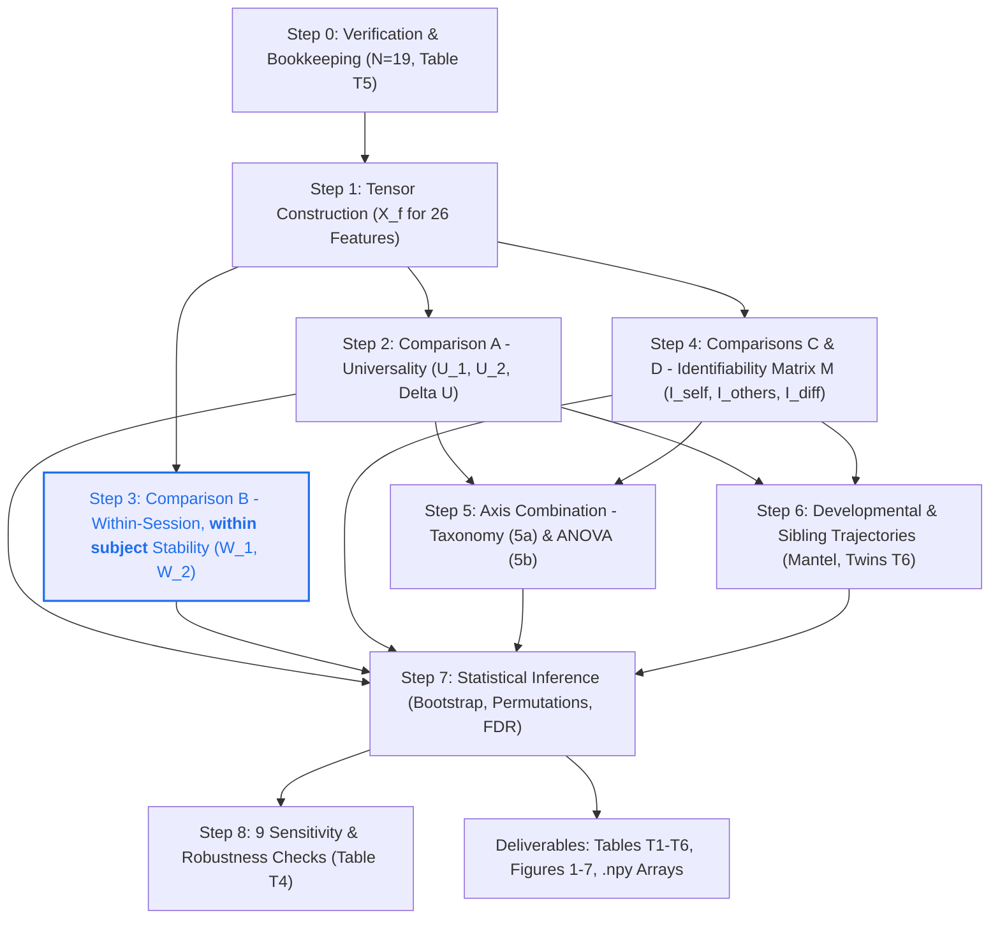

# Longitudinal Analysis Pipeline: Universality and Individuality of Infant EEG Network Constituents

*In plain words: which parts of an infant's brain-network activity are shared by all infants, and which parts are personal to each infant and stay stable as they grow?*

**Author:** Based on the specification by @Adi B (*Oct 20, 2026*)  
**Workspace:** `/home/aloo/HonoursM26`  
**Target cohort (the group of infants studied):** $N = 19$ infants followed over time ("longitudinal"), each recorded at two visits (`ses-1` and `ses-2`), with $K = 12$ clean, artifact-free epochs (short windows of recording) from each visit.

---

## How to read this document

This is the complete plan of the analysis: what is measured, how it is calculated, and why. It assumes no prior knowledge of the project.

* **Sections 1–4** explain the main idea, the infants, the data, and the similarity score that everything else is built on.
* **Section 5** walks through the analysis in the order it runs (Phases 1–8).
* **Section 6** lists everything the analysis produces, and **Section 7** shows where the code lives.
* **Section 8** collects the open questions and planned work, and **Section 9** lists the references cited.
* Every formula is followed by a plain-language explanation. If you meet a symbol or term you don't know, look it up in [Symbols and terms](#symbols-and-terms).

**Steps, phases and code files.** The original specification numbers the work as Steps 0–8, and each step has a Phase heading in Section 5. The code files, and the phase numbers that `run_full_analysis.py` prints, follow the same order up to Step 6 but are numbered differently after that:

| Step in this document | What it does | Code file | Phase number in `run_full_analysis.py` |
| :--- | :--- | :--- | :---: |
| Step 0 (Section 2) | Choose the infants | list fixed in `config.py` | – |
| Step 1 (Phase 1) | Build the feature data | `01_extract_tensors.py` | 1 |
| Step 2 (Phase 2) | Comparison A: universality | `02_compute_universality.py` | 2 |
| Step 3 (Phase 3) | Comparison B: within-session stability | `03_compute_within_session.py` | 3 |
| Step 4 (Phase 4) | Comparisons C & D: identifiability | `04_compute_identifiability.py` | 4 |
| Step 5 (Phase 5) | Combine universality and individuality | `05_taxonomy_and_variance.py` | 5 |
| Step 6 (Phase 6) | Development and twins | `06_developmental_and_twins.py` | 6 |
| Step 7 (Phase 7) | Rules for statistical testing | used inside files 02–06 | – |
| Step 8 (Phase 8) | Robustness checks | `07_robustness_checks.py` | 7 |
| Section 6 | Tables and figures | `08_export_tables.py`, `09_generate_figures.py` | 8, 9 |

$\Delta U$ (Phase 6, item 1) is calculated in `02_compute_universality.py` and then reported again by `06_developmental_and_twins.py`.

---

## Symbols and terms

### Counting and labelling

| Symbol | Meaning |
| :---: | :--- |
| $N$ | Number of infants: 19. |
| $a, b$ | Two infants, each numbered 1 to 19. $a \ne b$ means "two different infants". |
| $s$ | Session (visit). $s = 1$ is `ses-1`, the first visit (usually at about 3 months of age); $s = 2$ is `ses-2`, the second visit (usually at about 6 months). Exact ages are in Table T5. |
| $S = 2$ | In Section 3 only: the number of sessions. Everywhere else, $S$ is the similarity score below. |
| $K$ | Number of epochs used per recording: 12. |
| $k$ | One epoch, numbered 1 to 12 in time order. $k_1, k_2$ are two epochs being compared. |
| $n$ | Number of elements in a feature: 19 for node features, 171 for edge features. |
| $e$ | One element: an electrode (node) or a pair of electrodes (edge). |
| $f$ | One feature set, f01 to f26 (Section 3.2). |
| $g$ | One brain region, or one pair of regions (Section 3.1). |
| $i, j$ | Two electrodes, used when talking about the link between them. |
| $R, R_1, R_2$ | A recording: one infant at one session. |

### Data and network quantities

| Symbol | Meaning |
| :---: | :--- |
| $X_f$ | The data array (tensor) holding feature $f$ for all infants, sessions and epochs (Section 3). |
| $x(e)$ | The value of element $e$. With subscripts, $x_{a,s,k}(e)$ is the value for infant $a$, session $s$, epoch $k$, and $x_{R,k}(e)$ is the value in epoch $k$ of recording $R$. |
| $r_{ij}$ | Pearson correlation between the signals at electrodes $i$ and $j$: +1 means they always rise and fall together, −1 means they always move in opposite directions, 0 means no relationship. |
| $\lvert r_{ij} \rvert$ | Its absolute value: the sign is dropped, so it runs from 0 to 1. |
| $W_{ij}$, $w_{ij}$ | Weight (strength) of the link between electrodes $i$ and $j$ in the weighted network; here $W_{ij} = \lvert r_{ij} \rvert$. $W$ on its own is the whole 19 × 19 table of weights. |
| $A_{ij}$ | Adjacency: 1 if the link between $i$ and $j$ is kept in the binary network, 0 if not. $A$ on its own is the whole 19 × 19 table. |
| $d_{ij}$ | "Length" of a link when finding shortest routes: $d_{ij} = 1/w_{ij}$, so a strong link counts as a short route. |
| $\tau_c$ | "tau c": the critical threshold used to build the binary network (Section 3.2). |
| $u, v$ (in Section 3.2) | The two electrodes at the ends of a link. $w_{uv}$ is that link's weight. |
| $k_u$ | Strength (weighted network) or degree (binary network) of electrode $u$ (Section 3.2). |
| $c_u$ | Closeness of electrode $u$ (Section 3.2). |
| $E$ | The number of links in the network (Section 3.2). |

### Similarity scores and results

| Symbol | Meaning |
| :---: | :--- |
| $J(e)$ | Element-level weighted Jaccard similarity: how similar two recordings are at one element (Section 4.1). |
| $S$ | Recording-level weighted Jaccard similarity: how similar two recordings are over all elements at once (Section 4.1). $S^{(k_1, k_2)}$ is the score for one pair of epochs; $S_{R_1 R_2}$ is the average over all epoch pairs. |
| $P$, $\lvert P \rvert$ | The set of epoch pairs that are compared, and how many pairs it contains (Section 4.2). |
| $U_s(e)$, $U_s$, $u_s(a)$, $U_s(g)$ | Universality in session $s$: per element, for the whole recording, per infant, and per region (Phase 2). |
| $U(e)$ | Universality averaged over both sessions (Phase 5). |
| $\Delta U$, $\Delta U(e)$ | "delta U": the change in universality from `ses-1` to `ses-2` ($\Delta$ means "change in"). |
| $W_s(a)$, $W_s(a, e)$, $W_s$, $W_s(e)$ | Within-session self-similarity (Phase 3). |
| $O_s(a)$ | Matched-others baseline (Phase 3). |
| $M$, $M[a, b]$, $M_e$ | The 19 × 19 cross-session similarity matrix (Phase 4). $M[a, b]$ is the value in row $a$, column $b$. $M_e$ is the same matrix for a single element $e$. |
| $I_{\text{self}}$, $I_{\text{others}}$, $I_{\text{diff}}$ | Self-similarity, others-similarity and differential identifiability (Section 1 and Phase 4). Followed by $(e)$, they are the same quantities for one element. |
| $i_{\text{diff}}(a)$ | $I_{\text{diff}}$ for one infant $a$ (Phase 6). |
| $D[a, b]$ | The age difference between infants $a$ and $b$, in days (Phase 6). |

### Statistics

| Symbol | Meaning |
| :---: | :--- |
| $p$ | p-value: how likely a result at least this strong would be if only chance were at work. A small p-value (for example below 0.05) means chance is an unlikely explanation. |
| $q$ | q-value: a p-value adjusted for running many tests at once (FDR correction, Phase 7). Here $q < 0.05$ counts as significant. |
| $\pi$ | "pi": a random shuffle (permutation) of labels. It is not the number 3.14. |
| $\rho$ | "rho": Spearman rank correlation, from −1 to +1 (Phase 6). |
| $B$ | Number of bootstrap resamples (Phase 7). |
| $d_1, \dots, d_{19}$ | The 19 infants drawn in one bootstrap resample (Phase 7). |
| CI | Confidence interval: a range that plausibly contains the true value. A 95% CI is built so that it contains the true value 95% of the time. |
| SD | Standard deviation: how spread out a set of values is. |
| $\mu$ | "mu": the overall average in the mixed-effects model (Phase 5b). |
| $u_a$, $v_{a,s}$, $\varepsilon$ | The parts of the mixed-effects model (Phase 5b): the infant effect, the session effect and the leftover noise ("epsilon"). |
| $\sigma^2$ | "sigma squared": a variance, meaning how much something varies. $\sigma^2_{\text{Subject}}$ is the same as $\sigma^2_u$, $\sigma^2_{\text{Session}}$ the same as $\sigma^2_v$, and $\sigma^2_{\text{Epoch}}$ the same as $\sigma^2_\varepsilon$. |
| $\mathcal{N}(0, \sigma^2)$ | A normal (bell-shaped) distribution centred on 0 with variance $\sigma^2$. The sign $\sim$ means "is drawn from". |
| $\beta$ | "beta": the effect of age in the age-adjusted model (Phase 5b). |
| $\text{age}_c$ | Mean-centred age: an infant's age minus the average age of all recordings. |

### Maths notation

| Notation | Meaning |
| :---: | :--- |
| $\sum$ | "Sum": add up. $\sum_{e=1}^{n}$ means add up over elements 1 to $n$; $\sum_{a<b}$ means add up over every pair of different infants, counting each pair once (171 pairs); $\sum_{b \ne a}$ means add up over every infant except $a$ (18 infants). |
| $\frac{1}{171} \sum$ | Add up and divide by 171, i.e. take the average over 171 items. |
| $\min\{x, y\}$, $\max\{x, y\}$ | The smaller and the larger of two numbers. |
| $\arg\max_b M[a, b]$ | The value of $b$ that makes $M[a, b]$ largest, i.e. which column holds the biggest number in row $a$. |
| $\lvert x \rvert$ | Absolute value of a number (drop the minus sign). For a set, $\lvert P \rvert$ is the number of items in it. |
| $\in$ | "Is one of". $s \in \{1, 2\}$ means $s$ is 1 or 2. |
| $\{1, \dots, 12\}$ | The whole numbers from 1 to 12. |
| $\mathbb{R}^{19 \times 2 \times 12 \times n}$ | An array of real numbers ($\mathbb{R}$) with sizes 19, 2, 12 and $n$ along its four dimensions. |
| $\binom{19}{2}$ | "19 choose 2": the number of different pairs that can be formed from 19 items, $19 \times 18 / 2 = 171$. |
| NaN | "Not a Number": a placeholder stored where a value is undefined. |

**Letters with more than one meaning.** A few letters are reused, so check the context:

* $S$ is the similarity score, except in Section 3 where $S = 2$ is the number of sessions.
* $W$: $W$ and $W_{ij}$ are link weights, but $W_s$ and $W_s(a)$ (with a session subscript) are the within-session self-similarity of Phase 3.
* $u$: $u_s(a)$ is per-infant universality (Phase 2), $u_a$ is the infant effect in the mixed-effects model (Phase 5b), and in Section 3.2 $u$ (with $v$) names the two electrodes at the ends of a link.
* $d$: $d_{ij}$ is the length of a link, but $d_1, \dots, d_{19}$ are infants drawn in a bootstrap (Phase 7).
* $p, q$ are p-values and q-values, but in $d_p$ and $d_q$ (Phase 7) they are just positions in the bootstrap draw.
* $B$ is the number of bootstrap resamples, unrelated to infant $b$.
* $\beta$ is the age effect in Phase 5b, unrelated to the beta frequency band.

### Terms

| Term | Meaning |
| :--- | :--- |
| EEG | Electroencephalography: recording the brain's electrical activity with electrodes on the scalp. |
| Electrode / channel | One recording point on the scalp. This study uses 19, named by the standard 10–20 system: the letters give the area of the head (Fp = frontopolar, F = frontal, C = central, T = temporal, P = parietal, O = occipital), odd numbers are on the left, even numbers on the right, and Z marks the midline. |
| Session / visit | One recording appointment. Each infant has two. |
| Recording | One infant at one session. |
| Epoch / window | A short, clean piece of a recording, 2.56 seconds long. The two words mean the same thing in this document. |
| Artifact | Any part of the signal that does not come from the brain, such as movement or muscle activity. "Artifact-free" epochs contain none. |
| Network / graph | A set of nodes joined by edges. Here the nodes are electrodes and the edges are links between electrodes. |
| Node | An electrode in the network. |
| Edge / link / connection | The link between two electrodes. Its strength is how closely the two signals move together. This is *functional* connectivity: a statistical relationship between signals, not a physical wire. |
| Element | Whatever a feature has one value for: a node (19 of them) or an edge (171). |
| Feature / feature set | One way of describing the network with numbers, for example the strength of every electrode. There are 26, named f01 to f26. |
| Centrality | A number saying how important a node or an edge is within the network (Section 3.2). |
| Weighted network | Every link is kept, together with its strength. |
| Binary network | Only the strongest links are kept, and each one is simply present (1) or absent (0). |
| Broadband | The whole recorded signal, not split into frequency bands. In this dataset the recording system had already limited it to 0.5–30 Hz. |
| Frequency band | A range of rhythm speeds in the EEG: delta (0.5–4 Hz), theta (4–8 Hz), alpha (8–13 Hz) and beta (13–30 Hz). Hz (hertz) means cycles per second. |
| Tensor | A table of numbers with more than two dimensions; here, four. |
| TEFBN | Time-evolving functional brain network: the network built from one epoch. Because each recording gives 12 epochs, it gives 12 networks that change over time. |
| Universality | How similar infants are to one another: what they share. |
| Individuality / identifiability / fingerprinting | How much an infant resembles their own earlier recording more than they resemble other infants, so that they could be recognised, like a fingerprint. |
| Longitudinal | Following the same individuals over time. |
| Null model / null distribution | What results would look like if there were no real effect. It is built by shuffling the data. |
| Permutation test | Shuffle labels many times to build the null distribution. The p-value is how often a shuffled result matches or beats the real one. |
| Bootstrap | Redraw the infants at random, with repeats allowed, many times, and recompute a result each time. The spread of those results shows how uncertain the real result is and gives its confidence interval. |
| FDR (false discovery rate) | When many tests are run at once, some pass by luck. The Benjamini–Hochberg FDR correction adjusts p-values into q-values so that, among results called significant, the expected share of false positives stays at or below 5%. |
| Significant | Passes its statistical test after correction (here $q < 0.05$). |
| Mixed-effects model | A regression model that splits the variation in a measurement into parts, for example differences between infants, between sessions and between epochs. |
| GCC | Giant connected component: the largest group of nodes that can all reach one another through links. |
| Line graph | A derived network in which every link of the original network becomes a node, and two of these new nodes are joined if their original links share an electrode. It lets node measures be applied to links. |
| `.npy` | The file format NumPy (Python's main maths library) uses to save arrays. |

---

## 1. Executive Summary & Theoretical Framework

**The main question.** For every electrode (node) and every link between electrodes (edge), as described by each of the 26 network measures, this analysis separates two things:

* **Universal organization:** what is shared across all developing infants.
* **Individual uniqueness ("fingerprinting"):** what is stable and specific to each infant.

**How.** One similarity score is used everywhere: the **weighted Jaccard similarity** (Section 4.1), which runs from 0 (nothing in common) to 1 (identical). It is applied to four kinds of comparison, depending on whether the two recordings come from the same infant or different infants, and from the same session or different sessions:

| | **Same session** | **Different sessions (`ses-1` vs `ses-2`)** |
| :--- | :--- | :--- |
| **Same infant** | **B:** within-session stability ($W_1, W_2$) | **C:** longitudinal self-similarity ($I_{\text{self}}$) |
| **Different infants** | **A:** universality ($U_1, U_2$) | **D:** developmental baseline ($I_{\text{others}}$) |

In more detail:

| Comparison | What is compared | What it measures |
| :--- | :--- | :--- |
| **A:** between subjects, within session | Two different infants, both from the same session. Done separately for `ses-1` and for `ses-2`. | **Universality** ($U_1$, $U_2$): how similar infants are across the whole group. |
| **B:** within subject, within session | One infant's first half of epochs ($K/2 = 6$) against the same infant's second half (6), in the same session. | **Within-session stability** ($W_1$, $W_2$): how consistent an infant is over a few minutes. It also sets the short-term ceiling: the most similar a recording can be expected to be to anything. |
| **C:** within subject, between sessions | The same infant at `ses-1` against `ses-2` (about 3–4 months apart for most infants; see Table T5). | **Longitudinal self-similarity** ($I_{\text{self}}$): how much an infant resembles their own earlier recording. |
| **D:** between subjects, between sessions | Infant $a$ at `ses-1` against a different infant $b$ at `ses-2`. | **Null developmental baseline** ($I_{\text{others}}$): how similar recordings from the two visits are anyway when they come from different infants. "Null" means what you would see if there were no individual effect at all. |

> **Key idea (the theoretical axiom).** Individuality is **not** Comparison C on its own. It is defined as **differential identifiability**:
> $$I_{\text{diff}} = I_{\text{self}} - I_{\text{others}}$$
> Between the two visits, about 3 months apart, every infant's brain matures, and much of that maturation is shared by all infants. Shared maturation affects $I_{\text{self}}$ and $I_{\text{others}}$ in the same way, so subtracting $I_{\text{others}}$ removes it and isolates what is truly specific to each infant from normal development.
>
> *Example:* suppose recordings of the same infant at the two visits have a similarity of 0.80 on average ($I_{\text{self}}$), while a first-visit recording and a *different* infant's second-visit recording have a similarity of 0.75 on average ($I_{\text{others}}$). Only the difference, 0.05, reflects individuality. Whenever $I_{\text{diff}}$ is above zero, infants look more like their own past selves than like anyone else.

---

## 2. Cohort Definition & Subject Bookkeeping (Step 0)

The *cohort* is the group of infants studied. *Bookkeeping* means keeping track of who is included and their details.

### 2.1 Cohort Selection Rationale ($N = 19$)

The raw dataset (in `Infants_data/`) contains 103 infants, and 22 of them were recorded at both sessions (`ses-1` and `ses-2`).

Step 0 keeps only infants who have at least $K = 12$ usable epochs in **both** sessions. A usable epoch is a 2.56-second window that experts have marked ("annotated") as artifact-free and that was recorded while the infant's eyes were closed. Three of the 22 infants fail this rule:

* `sub-NORB00074`: excluded (only 1 window at `ses-1`).
* `sub-NORB00085`: excluded (only 8 windows at `ses-1`).
* `sub-NORB00082`: excluded (20 windows at `ses-1`, but only **1 window at `ses-2`**).

**Cross-checked against the dataset itself.** Counting the raw files gives 103 infants, of whom 22 have an EEG recording at both sessions. Counting the expert annotation files of those 22 gives exactly the three exclusions above, and the 19 infants that remain are exactly the list in `config.py`. One detail: the single `ses-2` window of `sub-NORB00082` runs past the end of its recording, so that infant actually has 0 usable windows at `ses-2`.

**Selected cohort:** exactly **19 infants** have $K \ge 12$ ("at least 12") windows in both sessions. For every infant, the first $K = 12$ windows in time order ("chronological") are used, so that every recording contributes the same amount of data.

### 2.2 Table T5: Subject Bookkeeping Table

Two counts are used throughout the analysis:

* **Pairs of infants within a session:** $\binom{19}{2} = 171$. From 19 infants you can form $19 \times 18 / 2 = 171$ different pairs, counting each pair once.
* **Cross-session identifiability matrix $M$** (Phase 4): a $19 \times 19$ table with the `ses-1` recordings as rows and the `ses-2` recordings as columns. It holds $19$ self pairs (the same infant at both visits, on the diagonal) and $342$ cross-subject pairs (two different infants, $19 \times 18$). Here order matters, because infant $a$ at `ses-1` with infant $b$ at `ses-2` is a different comparison from $b$ at `ses-1` with $a$ at `ses-2`. That is why there are 342 rather than 171.

How to read the table: ages are in months (mo) at each visit; the *inter-session gap* is the time between the two visits; the *Epochs* columns give how many usable windows were annotated in each session (only the first 12 are used); *Singleton* means the infant is not a twin. The ages were checked against the dataset's `scans.tsv` files, which give age in years (multiplied by 12 here); all 19 rows match. In three recordings the *Epochs* count includes one annotated window that runs past the end of the recording and cannot be used: `sub-NORB00079` `ses-1` (14 usable), and `sub-NORB00087` `ses-1` and `ses-2` (19 usable each). This does not affect who is included.

| Participant ID | Sex | Age `ses-1` (mo) | Age `ses-2` (mo) | Inter-session Gap (mo) | Epochs `ses-1` | Epochs `ses-2` | Note / Status |
| :--- | :---: | :---: | :---: | :---: | :---: | :---: | :--- |
| `sub-NORB00064` | M | 5.11 | 5.25 | 0.13 | 13 | 20 | Singleton (Short test-retest gap: ~4 days) |
| `sub-NORB00065` | M | 5.21 | 9.57 | 4.36 | 20 | 20 | Singleton |
| `sub-NORB00069` | F | 4.62 | 6.00 | 1.38 | 15 | 20 | Singleton (Intermediate gap: ~42 days) |
| `sub-NORB00070` | M | 3.05 | 6.07 | 3.02 | 15 | 20 | Singleton |
| `sub-NORB00075` | M | 3.20 | 6.07 | 2.87 | 20 | 20 | Singleton |
| `sub-NORB00077` | M | 3.02 | 5.90 | 2.88 | 20 | 20 | Singleton |
| `sub-NORB00078` | M | 3.02 | 5.72 | 2.70 | 20 | 20 | Singleton |
| `sub-NORB00079` | M | 2.95 | 5.66 | 2.71 | 15 | 20 | Singleton |
| `sub-NORB00080` | M | 2.98 | 6.70 | 3.72 | 20 | 20 | Singleton |
| `sub-NORB00081` | F | 3.51 | 6.86 | 3.35 | 15 | 20 | Singleton |
| `sub-NORB00083` | F | 3.03 | 6.53 | 3.50 | 20 | 20 | Singleton |
| `sub-NORB00084` | F | 3.33 | 6.67 | 3.34 | 15 | 20 | Singleton |
| `sub-NORB00086` | M | 2.85 | 6.30 | 3.45 | 20 | 20 | **Twin A** (Brother of `00087`) |
| `sub-NORB00087` | M | 2.85 | 6.30 | 3.45 | 20 | 20 | **Twin B** (Brother of `00086`) |
| `sub-NORB00089` | M | 3.00 | 6.56 | 3.56 | 24 | 20 | Singleton |
| `sub-NORB00090` | F | 3.02 | 6.36 | 3.34 | 15 | 20 | Singleton |
| `sub-NORB00094` | F | 3.17 | 6.50 | 3.33 | 12 | 20 | Singleton |
| `sub-NORB00096` | M | 2.73 | 6.00 | 3.27 | 20 | 20 | Singleton |
| `sub-NORB00103` | F | 2.89 | 6.28 | 3.39 | 35 | 20 | Singleton |

---

## 3. The 26 Feature Sets & Input Tensors (Step 1)

**What a feature is.** For every epoch, the EEG is turned into a network: the 19 electrodes are the nodes, and every pair of electrodes is joined by an edge whose strength is how closely their two signals rise and fall together (their correlation). A *feature set* is one way of describing that network with numbers: either one number per electrode (a **node feature**, 19 numbers) or one number per pair of electrodes (an **edge feature**, 171 numbers).

Every analysis reads its data from one tensor per feature set:
$$X_f \in \mathbb{R}^{19 \times 2 \times 12 \times n}$$
Read this as: "$X_f$ is a four-dimensional array of real numbers, of size 19 × 2 × 12 × $n$". The four dimensions are:

* **Infants ($N=19$):** in fixed alphanumeric order (`sub-NORB00064` to `sub-NORB00103`).
* **Sessions ($S=2$):** $s \in \{1, 2\}$ (`ses-1`, `ses-2`).
* **Epochs ($K=12$):** $k \in \{1, \dots, 12\}$, the chronological artifact-free segments.
* **Elements ($n$):** $n = 19$ for node features; $n = 171$ for edge features.

So each feature set holds $19 \times 2 \times 12 \times 19 = 8{,}664$ values for a node measure (vertices) or $19 \times 2 \times 12 \times 171 = 77{,}976$ values for an edge measure, for one type of centrality.

*Example:* in feature f01, the value for infant 3, session 2, epoch 5 and element 1 is the strength of the `Fp1`–`Fp2` link in the fifth window of infant 3's second visit. Python counts from 0, so in the code this is `X[2, 1, 4, 0]`.

### 3.1 Fixed Element Ordering

The elements are always stored in the same order, in every file and for every infant, so that element number $e$ always refers to the same electrode or pair of electrodes. This is what makes element-by-element comparisons possible, and it keeps results strictly reproducible.

* **19 nodes**, grouped by region from the front of the head to the back: Frontal (`Fp1, Fp2, F3, F4, F7, F8, FZ`), Central (`C3, C4, CZ`), Temporal (`T3, T4, T5, T6`), Parietal (`P3, P4, PZ`), Occipital (`O1, O2`).
* **171 edges**, grouped into 15 anatomical region pairs, ordered from pairs of regions that are close together on the head to pairs that are far apart ("increasing inter-region distance"). The number in brackets is how many edges each group contains:
  `F-F` (21), `F-C` (21), `F-T` (28), `F-P` (21), `F-O` (14), `C-C` (3), `C-T` (12), `C-P` (9), `C-O` (6), `T-T` (6), `T-P` (12), `T-O` (8), `P-P` (3), `P-O` (6), `O-O` (1).

  For example, `F-F` are the links between two frontal electrodes: 7 frontal electrodes give $7 \times 6 / 2 = 21$ pairs. `F-C` are the links between one of the 7 frontal and one of the 3 central electrodes: $7 \times 3 = 21$.

### 3.2 Feature Set Taxonomy

"Taxonomy" means classification. The table lists all 26 feature sets; the explanations below it describe each column.

| Feature ID | Signal used (feature domain) | Network type (representation) | What is measured (centrality / metric) | Dimension ($n$) | How it is computed (distance metric / binarization) |
| :---: | :--- | :--- | :--- | :---: | :--- |
| **f01** | Broadband | Weighted | Correlation weight $W_{ij} = \lvert r_{ij} \rvert$ | 171 | Direct absolute correlation |
| **f02** | Broadband | Weighted | Node Betweenness | 19 | Brandes algorithm, $d_{ij} = 1/w_{ij}$ |
| **f03** | Broadband | Weighted | Edge Betweenness | 171 | Girvan-Newman, $d_{ij} = 1/w_{ij}$ |
| **f04** | Broadband | Weighted | Node Strength | 19 | Sum of incident edge weights |
| **f05** | Broadband | Weighted | Edge Strength | 171 | Corrected average strength of incident endpoints: $\frac{k_u + k_v - 2w_{uv}}{\lvert k_u - k_v \rvert + 1}\, w_{uv}$ |
| **f06** | Broadband | Weighted | Node Eigenvector | 19 | Principal eigenvector of $W$ |
| **f07** | Broadband | Weighted | Edge Eigenvector | 171 | Line graph eigenvector centrality |
| **f08** | Broadband | Weighted | Node Closeness | 19 | Standard (not harmonic) shortest-path closeness, $d_{ij} = 1/w_{ij}$ |
| **f09** | Broadband | Weighted | Edge Closeness | 171 | From the closeness of the two endpoints: $(E-1)\frac{c_u c_v}{c_u + c_v}$ |
| **f10** | Broadband | Binary | Adjacency matrix $A_{ij}$ | 171 | GCC adaptive threshold ($\tau_c$) |
| **f11** | Broadband | Binary | Node Betweenness | 19 | Unweighted shortest paths |
| **f12** | Broadband | Binary | Edge Betweenness | 171 | Unweighted shortest paths |
| **f13** | Broadband | Binary | Node Degree | 19 | Unweighted degree |
| **f14** | Broadband | Binary | Edge Strength | 171 | Corrected average degree of incident endpoints: $\frac{k_u + k_v - 2}{\lvert k_u - k_v \rvert + 1}$ |
| **f15** | Broadband | Binary | Node Eigenvector | 19 | Principal eigenvector of $A$ |
| **f16** | Broadband | Binary | Edge Eigenvector | 171 | Line graph unweighted eigenvector |
| **f17** | Broadband | Binary | Node Closeness | 19 | Unweighted shortest path |
| **f18** | Broadband | Binary | Edge Closeness | 171 | From the unweighted closeness of the two endpoints: $(E-1)\frac{c_u c_v}{c_u + c_v}$ |
| **f19** | Delta (0.5–4 Hz) | Weighted | Edge Weight $W_{ij}$ | 171 | Absolute Pearson $r$ on filtered EEG |
| **f20** | Delta (0.5–4 Hz) | Binary | Edge Adjacency $A_{ij}$ | 171 | GCC adaptive threshold ($\tau_c$) |
| **f21** | Theta (4–8 Hz) | Weighted | Edge Weight $W_{ij}$ | 171 | Absolute Pearson $r$ on filtered EEG |
| **f22** | Theta (4–8 Hz) | Binary | Edge Adjacency $A_{ij}$ | 171 | GCC adaptive threshold ($\tau_c$) |
| **f23** | Alpha (8–13 Hz) | Weighted | Edge Weight $W_{ij}$ | 171 | Absolute Pearson $r$ on filtered EEG |
| **f24** | Alpha (8–13 Hz) | Binary | Edge Adjacency $A_{ij}$ | 171 | GCC adaptive threshold ($\tau_c$) |
| **f25** | Beta (13–30 Hz) | Weighted | Edge Weight $W_{ij}$ | 171 | Absolute Pearson $r$ on filtered EEG |
| **f26** | Beta (13–30 Hz) | Binary | Edge Adjacency $A_{ij}$ | 171 | GCC adaptive threshold ($\tau_c$) |

**Signal used.** *Broadband* features (f01–f18) use the whole recorded signal; in this dataset the recording system had already limited it to 0.5–30 Hz. The *frequency-band* features (f19–f26) first filter the EEG so that only one band remains: delta (the slowest rhythms), theta, alpha or beta (the fastest).

> **Note for later:** these bands can be split further into sub-bands (for example $\alpha_1$, $\alpha_2$), and the literature has reported improved or emerging results within such sub-ranges. They are not analysed yet (Section 8).

**Network type.**

* **Weighted:** every link is kept, with weight $W_{ij} = \lvert r_{ij} \rvert$, the absolute Pearson correlation between the two electrodes' signals. Taking the absolute value also makes every weight non-negative, which the similarity score requires (Section 4.1).
* **Binary:** only the strongest links are kept, and each is simply present ($A_{ij} = 1$) or absent ($A_{ij} = 0$). Which links are kept is decided by the **GCC adaptive threshold**, separately for every epoch:
  1. Start with a threshold of 1.0 and keep only the links with $\lvert r_{ij} \rvert$ at or above it.
  2. Lower the threshold in steps of 0.05 until all 19 electrodes are joined into a single network, i.e. the giant connected component (GCC) contains all 19 nodes.
  3. That threshold is $\tau_c$ (the "critical" threshold). It gives the sparsest network in which every electrode is still connected.

**What is measured.** Each measure exists in a node version (one value per electrode) and, mostly, an edge version (one value per link):

* **Correlation weight / edge weight** (f01, f19, f21, f23, f25): the link strength $\lvert r_{ij} \rvert$ itself.
* **Adjacency** (f10, f20, f22, f24, f26): whether each link is kept (1) or not (0).
* **Betweenness** (f02, f03, f11, f12): how often an electrode or a link lies on the shortest route between two other electrodes, like a busy junction on a road map. In weighted networks the length of a link is $d_{ij} = 1/w_{ij}$, so strong links are short routes; in binary networks every link has length 1 ("unweighted"). The Brandes algorithm is the standard fast way to compute node betweenness; Girvan–Newman refers to the edge version of betweenness, introduced in Girvan and Newman's work on network communities.
* **Strength and degree** (f04, f13): a node's strength is the sum of the weights of all links touching it (its "incident" edges); its degree is simply the number of links touching it, used for binary networks.
* **Edge strength** (f05, f14): a *corrected* average of the strengths (weighted) or degrees (binary) of the two electrodes $u$ and $v$ at the ends of the link (its "incident endpoints"):
  $$\text{edge strength}(u, v) = \frac{k_u + k_v - 2w_{uv}}{\lvert k_u - k_v \rvert + 1} \times w_{uv}$$
  Three corrections are built in: subtracting $2w_{uv}$ removes the link itself, which is counted once in $k_u$ and once in $k_v$; dividing by $\lvert k_u - k_v \rvert + 1$ lowers the value when the two endpoints are very unequal; and multiplying by $w_{uv}$ scales the result by the link's own strength. In the binary version (f14) every $w_{uv} = 1$ and $k$ is the degree, so it becomes $\frac{k_u + k_v - 2}{\lvert k_u - k_v \rvert + 1}$.
* **Eigenvector centrality** (f06, f07, f15, f16): an electrode is important if it is linked to other important electrodes, like being popular among popular people. Mathematically the values come from the principal eigenvector (the dominant pattern) of the weight table $W$ or the adjacency table $A$. The edge versions are computed on the line graph, where each link becomes a node.
* **Closeness** (f08, f09, f17, f18): how near an electrode is to all the others; short routes to everyone mean high closeness. Node closeness $c_u$ is the standard version: (number of other electrodes) divided by the sum of the shortest-route lengths from $u$ to all of them. The edge versions are *not* computed on the line graph; they combine the closeness of the two endpoints:
  $$\text{edge closeness}(u, v) = (E - 1)\,\frac{c_u\, c_v}{c_u + c_v}$$
  where $E$ is the number of links in the network (formula as cited in `utils.py`, Bröhl & Lehnertz, 2022).

**Dimension ($n$)** is 19 for node features and 171 for edge features.

---

## 4. Mathematical Definitions & Methodological Rules

Every result in this analysis comes from one similarity score, the **weighted Jaccard similarity**, used at two levels: one element at a time ($J$) and a whole recording at once ($S$).

### 4.1 Weighted Jaccard Formulation & 0/0 Rule

Take two lists of non-negative numbers, $x_1$ and $x_2$ (written $x_1, x_2 \ge 0$), for example the 171 link strengths of two different windows. $x_1(e)$ and $x_2(e)$ are their values at element $e$.

1. **Element-level Jaccard $J(e)$:**
   $$J(e) = \frac{\min\{x_1(e), x_2(e)\}}{\max\{x_1(e), x_2(e)\}}$$
   Divide the smaller value by the larger one. Identical values give 1; if one value is 0 and the other is not, the result is 0. *Example:* values 0.6 and 0.8 give $0.6 / 0.8 = 0.75$.
   * **The $0/0$ rule:** when both $x_1(e) = 0$ and $x_2(e) = 0$, the ratio is undefined ($0/0$). It is stored as `NaN` and left out when averaging, using `np.nanmean` (NumPy's average that skips `NaN`). This follows the classical Jaccard definition, which ignores joint absences: an element missing from both recordings (for example a link that neither binary network kept) says nothing about how similar they are.
   * If all pairs for an element are `NaN`, then $J(e) = \text{NaN}$. The fraction of undefined comparisons is tracked and reported for every element in Table T2.
   * The older ("legacy") rule, $0/0 \to 0$, which counts a joint absence as complete disagreement, is tested separately as Step 8 sensitivity check 1. So both rules are run: `NaN` in the main analysis, $0/0 \to 0$ in check 1.
   * **How often this happens.** 0/0 cases only occur in features that contain zeros. In `ses-1`, the average share of element comparisons that are 0/0 is about 50% for the binary edge features (f10, f12, f14, f16, f18, f20, f22, f24, f26: from 49% to 57%), 25% for f02, 20% for f03 and 8% for f11, and 0% for all other features. These comparisons are left out of the element averages ($J(e)$, $U_s(e)$, $W_s(a, e)$, $I_{\text{diff}}(e)$), and their share is reported per element in Table T2.
   * **Open decision.** The supervisor recalls deciding that $0/0 = 0$ should be the main rule, for physiological reasons; the code currently uses `NaN` as the main rule. Switching would change all element-level results for the features listed above (Section 8).

2. **Recording-level weighted Jaccard $S$:**
   This compares two whole windows at once, using all elements together. For an epoch pair $(k_1, k_2)$, meaning window $k_1$ of recording $R_1$ and window $k_2$ of recording $R_2$:
   $$S^{(k_1, k_2)} = \frac{\sum_{e=1}^n \min\{x_{R_1, k_1}(e), x_{R_2, k_2}(e)\}}{\sum_{e=1}^n \max\{x_{R_1, k_1}(e), x_{R_2, k_2}(e)\}}$$
   In words: for every element take the smaller of the two values and add them all up; do the same with the larger values; divide the first total by the second. Elements with large values therefore count for more than elements with small values. *Example* with three elements: $x_1 = [7, 2, 4]$ and $x_2 = [5, 3, 4]$ give $(5 + 2 + 4) / (7 + 3 + 4) = 11 / 14 = 0.79$.
   * Joint absences ($0 + 0$) simply add 0 to both totals, so no special rule is needed.
   * **Edge case at this level:** if *every* element is 0 in both windows, both totals are 0 and $S$ is again $0/0$. The code then sets $S = 0$, so at the recording level the $0/0 \to 0$ rule is the one used. This only happens in f02 (node betweenness), where 7 of the 456 epochs have all 19 values equal to 0; if only one of the two windows is all zero, $S = 0$ in the normal way.
   * The overall similarity of two recordings is the average over the set $P$ of epoch pairs being compared (Section 4.2), where $(k_1, k_2) \in P$ means "each pair of windows in $P$" and $\lvert P \rvert$ is how many pairs there are:
     $$S_{R_1 R_2} = \frac{1}{|P|} \sum_{(k_1, k_2) \in P} S^{(k_1, k_2)}$$

### 4.2 Epoch Pairing Schemes ($P$)

When two recordings are compared, their windows are compared in pairs and the results are averaged (Section 4.1). The *pairing scheme* decides which windows are paired with which.

| Comparison | Description | Pairing Set $P$ | Count $\lvert P \rvert$ |
| :--- | :--- | :--- | :---: |
| **A, C, D** | Cross-recording (between infants or between sessions) | Matched indices: $(k, k)$ for $k \in \{1, \dots, K\}$ | $K = 12$ |
| **B** | Within-session split-half stability | Half-shift: $(k, k + K/2)$ for $k \in \{1, \dots, K/2\}$ | $K/2 = 6$ |
| **Step 8 (Check 2)** | Robustness check | All combinatorial pairs: $(k_1, k_2)$ for all $k_1, k_2$ | $K \times K = 144$ |

In words:

* **A, C, D:** window 1 with window 1, window 2 with window 2, and so on up to window 12 (12 pairs).
* **B:** within a single recording, window 1 with window 7, window 2 with window 8, and so on up to 6 with 12. This compares the first half of the session with the second half (6 pairs).
* **Step 8, check 2:** every window with every window ($12 \times 12 = 144$ pairs), to test whether the choice of pairing changes the results.

### 4.3 From Windows to One Number: Where the Network Is Reduced

Every comparison shrinks many numbers down to one, always in the same order. Taking Comparison A for one feature as the example (infants $a$ and $b$, session $s$):

| Level | What is combined | Result |
| :--- | :--- | :--- |
| 1. One element, one window pair | $J$ for element $e$ between window $k$ of infant $a$ and window $k$ of infant $b$ | one number per element per window pair |
| 2a. Element-level route | average the level-1 values over the 12 window pairs (skipping 0/0) | $J_{(a,s), (b,s)}(e)$: one number per element for this pair of infants |
| 2b. Recording-level route | inside each window pair, combine all $n$ elements at once into $S^{(k, k)}$ (sum of minima ÷ sum of maxima); then average the 12 scores | $S_{(a,s), (b,s)}$: one number for this pair of infants |
| 3. Over infants | average over the 171 pairs (or over the 18 other infants, or the 19 infants) | $U_s(e)$, $U_s$, $u_s(a)$, … |

So the network itself, i.e. all its elements, is combined into one number only in the recording-level route, and this happens **inside each window pair, before any averaging over windows or infants**. The element-level route never combines elements: it keeps one value per element to the end. Phases 3 and 4 follow exactly the same order, only with a different pairing (Section 4.2) and different recordings.

---

## 5. Sequential Step-by-Step Implementation Phases

The analysis runs as a sequence of steps. In the diagram, an arrow from one step to another means that the second step uses the results of the first. "ANOVA" in Step 5 refers to the variance decomposition of Step 5b.



---

### Phase 1: Feature Tensor Construction (Step 1)

* **Goal:** build the 26 feature tensors $X_f \in \mathbb{R}^{19 \times 2 \times 12 \times n}$ (Section 3) and save them as intermediate files in `processed_tensors/`.
* **How it is done:**
  1. Load the precomputed absolute correlation matrices for `ses-1` and `ses-2` from `correlation_matrices_segment_wise_absolute/` (kept in `legacyCode/`). Each file is a 19 × 19 table of $\lvert r_{ij} \rvert$ values for one window. These files were created earlier from the raw recordings, using the same annotated windows.
  2. Apply GCC thresholding (Section 3.2) to each window to obtain the binary adjacency $A_{ij}$. For each window, the critical threshold $\tau_c$ and the number of links kept are saved (the number of links is stored under the name "density").
  3. Compute the graph centrality measures (node and edge betweenness, strength, eigenvector and closeness) with `networkx`, a Python library for networks.
  4. For the 8 frequency-band features, load the raw recordings (EDF files) for both sessions, filter them to delta, theta, alpha and beta, compute the Pearson $\lvert r \rvert$ for each window, and binarize it with the GCC threshold.

     **Filtering is done on the entire recording, not window by window.** Each continuous recording is band-pass filtered as a whole (zero-phase FIR filter, `mne` `filter`), and only then are the first 12 annotated windows cut out. Filtering each short 2.56-second window on its own would distort its beginning and end (edge effects); filtering the whole signal first avoids this. (Reference to the manuscript to be added.)

---

### Phase 2: Universality Across the Population (Step 2 — Comparison A)

* **Goal:** measure how much infants share, i.e. how similar the network organization ("topology") is across the whole group, separately for each session ($s \in \{1, 2\}$).
* **Metrics:**
  1. **Element-level universality:** how similar infants are at one element $e$, averaged over all 171 pairs of infants in session $s$:
     $$U_s(e) = \frac{1}{171} \sum_{a < b} J_{(a,s), (b,s)}(e)$$
     Here $J_{(a,s), (b,s)}(e)$ is the Jaccard similarity at element $e$ between infant $a$ and infant $b$, both in session $s$, averaged over their 12 matched window pairs. Before averaging over pairs, these values form a table of 171 rows (one per pair of infants) and $n$ columns, i.e. a $171 \times n$ matrix per feature and session; $U_s(e)$ is the average of each column. Undefined ($0/0$) values are skipped in the averages.
  2. **Recording-level universality:** the same idea using the whole-recording score $S$, giving one number per feature and session:
     $$U_s = \frac{1}{171} \sum_{a < b} S_{(a,s), (b,s)}$$
     Step by step, for every pair of infants $(a, b)$ in session $s$:
     1. For each of the 12 matched window pairs $(k, k)$, combine all $n$ elements into one score $S^{(k, k)}$ (sum of minima ÷ sum of maxima, Section 4.1). This is where each network is reduced to a single number (Section 4.3).
     2. Average the 12 scores to get $S_{(a,s), (b,s)}$, the similarity of the two infants' whole networks.
     3. Average over all 171 pairs to get $U_s$: one number per feature and session, saying how alike infants' whole networks are.

     The 171 values $S_{(a,s), (b,s)}$ also fill the $19 \times 19$ grid saved as `S_mat_{fid}_{ses}.npy`.
  3. **Per-infant universality:** how similar infant $a$ is, on average, to the other 18 infants. A low value means the infant is unusual compared with the group.
     $$u_s(a) = \frac{1}{18} \sum_{b \ne a} S_{(a,s), (b,s)}$$
     Yes, $a$ and $b$ are infant (subject) indices. "Per-infant universality" and "universality across the population" do not contradict each other: $u_s(a)$ is infant $a$'s share of the population value, i.e. how *typical* infant $a$ is of the group. Averaging $u_s(a)$ over all 19 infants gives back exactly $U_s$, because every pair is counted once from each side:
     $$\frac{1}{19} \sum_{a=1}^{19} u_s(a) = \frac{1}{19 \times 18} \sum_{a \ne b} S_{(a,s), (b,s)} = \frac{1}{171} \sum_{a < b} S_{(a,s), (b,s)} = U_s$$
     So $U_s$ describes the group, and $u_s(a)$ shows each infant's contribution to it; "per-infant typicality" may be a clearer name.
  4. **Regional universality:** $U_s(g)$, the average of $U_s(e)$ over the elements in region $g$, for each of the 5 node regions and the 15 edge region pairs (Section 3.1).
  5. **Element-shuffle null model (significance testing):** checks whether infants are similar at the *same* elements, rather than merely having values in a similar range.
     * For each infant pair $(a, b)$, shuffle the element labels of the second infant with a random permutation $\pi$, so that, for example, infant $a$'s `Fp1` is compared with infant $b$'s `O2`. The same shuffle is used for all 12 windows of that pair, and every pair gets its own shuffle.
     * Recompute $U_s(e)$ (and $U_s$) from the shuffled data. Repeat this for 200,000 iterations.
     * One-sided $p$-value ("one-sided" because the only question is whether the real similarity is *higher* than chance):
       $$p = \frac{1 + \sum [\text{null} \ge \text{observed}]}{1 + 200{,}000}$$
       Here $[\text{null} \ge \text{observed}]$ is 1 when a shuffled result is at least as large as the real one and 0 otherwise, so the sum counts those shuffles. Adding 1 on top and bottom counts the real result as one of the possible outcomes, so $p$ can never be exactly 0.

---

### Phase 3: Within-Session Stability (Step 3 — Comparison B)

* **Goal:** measure how similar each infant is to themselves within a single session. Two halves of the same session should be about as similar as recordings can get, so this sets the theoretical ceiling for self-similarity. It also shows how much an infant's network changes from moment to moment (short-term state variability).
* **Metrics:**
  1. **Epoch split:** for each infant and session, split the 12 epochs into a first half ($k \in \{1, \dots, 6\}$) and a second half ($k \in \{7, \dots, 12\}$), and pair them as $(k, k+6)$: window 1 with 7, 2 with 8, and so on.
  2. **Self-similarity:** the similarity between an infant's own first and second halves. The reduction follows the order of Section 4.3:
     * Element-level: $W_s(a, e) = J_{(a,s,\text{first}), (a,s,\text{second})}(e)$. For element $e$, compute $J$ between window $k$ and window $k+6$ of infant $a$, for $k = 1, \dots, 6$, and average the 6 values (skipping 0/0). Elements are never combined: the result is one number per element per infant.
     * Recording-level: $W_s(a) = S_{(a,s,\text{first}), (a,s,\text{second})}$. For each of the 6 window pairs $(k, k+6)$, combine all $n$ elements into one score $S^{(k, k+6)}$ (sum of minima ÷ sum of maxima); this is where the network is reduced to a single number. Then average the 6 scores: one number per infant.
     * Cohort mean: the average over all 19 infants, per element and for the whole recording:
       $$W_s(e) = \frac{1}{19} \sum_{a=1}^{19} W_s(a, e), \qquad W_s = \frac{1}{19} \sum_{a=1}^{19} W_s(a)$$
       These describe how stable infants are within a session in general, rather than one infant in particular.
  3. **Matched-others baseline:** the same comparison, but against *other* infants. Compare infant $a$'s first half with infant $b$'s second half ($b \ne a$), using the same pairing $(k, k+6)$, and average over the 18 other infants:
     $$O_s(a) = \frac{1}{18} \sum_{b \ne a} S_{(a,s,\text{first}), (b,s,\text{second})}$$
     The $\frac{1}{18}$ is an average over the other infants. **Is there also a normalisation within each infant's own network?** No separate step is applied, for two reasons. First, the score $S$ is already a ratio inside every window pair (sum of minima ÷ sum of maxima), so it always lies between 0 and 1. Second, item 4 below subtracts $O_s(a)$ from $W_s(a)$, so each infant is measured against their own baseline. The feature values themselves are not rescaled per infant or per window in the main analysis. A difference in the overall level of two networks therefore does lower $S$; Step 8 check 5 (pattern-only normalisation, where each window's values are divided by their total) tests whether that matters.
  4. **Within-session identifiability:** $W_s(a) - O_s(a)$, i.e. how much more an infant resembles themselves than others within one session. It is tested against 0 with the infant-level bootstrap (Phase 7).
  5. **Odd/even sensitivity:** repeat the split with a different pairing, matching each odd-numbered epoch with the even-numbered epoch right after it, $(k, k+1)$: window 1 with 2, 3 with 4, and so on up to 11 with 12. These windows are closer together in time.

---

### Phase 4: Longitudinal Identifiability & Fingerprinting (Step 4 — Comparisons C & D)

* **Goal:** build the cross-session similarity matrix $M$ and measure how well each infant can be recognised from one visit to the next ("fingerprinting") as they develop.
* **Metrics:**
  1. **Identifiability matrix $M \in \mathbb{R}^{19 \times 19}$:** the similarity between infant $a$'s `ses-1` recording and infant $b$'s `ses-2` recording:
     $$M[a, b] = S_{(a, 1), (b, 2)}$$
     Rows = `ses-1`, columns = `ses-2`. The diagonal cells $M[a, a]$ compare an infant with themselves (Comparison C); all other cells compare two different infants (Comparison D).
  2. **Global identifiability parameters:**
     * Self-similarity (Comparison C), the average of the 19 diagonal cells:
       $$I_{\text{self}} = \frac{1}{19} \sum_{a=1}^{19} M[a, a]$$
     * Others-similarity (Comparison D), the average of the $19 \times 18 = 342$ off-diagonal cells:
       $$I_{\text{others}} = \frac{1}{19 \times 18} \sum_{a \ne b} M[a, b]$$
     * **Differential identifiability**, multiplied by 100 so that it reads on a 0–100 scale (a difference of 0.05 becomes 5):
       $$I_{\text{diff}} = (I_{\text{self}} - I_{\text{others}}) \times 100$$
  3. **Identification accuracy (1-nearest neighbour):** can each infant be picked out from the group?
     * **Forward (`ses-1` $\to$ `ses-2`):** for infant $a$'s first-visit recording (row $a$), the predicted identity is the second-visit recording it is most similar to, $\arg\max_b M[a, b]$ (the column with the highest value in that row). The prediction is correct if $b = a$.
     * **Backward (`ses-2` $\to$ `ses-1`):** for infant $b$'s second-visit recording (column $b$), the predicted identity is $\arg\max_a M[a, b]$ (the row with the highest value in that column). The prediction is correct if $a = b$.
     * Ties (two cells sharing the highest value) count as incorrect. Guessing at random among 19 infants would be right $1/19 = 5.26\%$ of the time; this is the chance baseline.
  4. **Element-level identifiability:** the same calculations done one element at a time. Compute $M_e[a, b] = J_{(a, 1), (b, 2)}(e)$, the average of $J(e)$ over the 12 matched window pairs, to obtain $I_{\text{self}}(e)$, $I_{\text{others}}(e)$ and $I_{\text{diff}}(e)$:
     $$I_{\text{self}}(e) = \frac{1}{19} \sum_{a=1}^{19} M_e[a, a], \qquad I_{\text{others}}(e) = \frac{1}{19 \times 18} \sum_{a \ne b} M_e[a, b]$$
     $$I_{\text{diff}}(e) = \big(I_{\text{self}}(e) - I_{\text{others}}(e)\big) \times 100$$
     Undefined (0/0) cells are skipped in these averages.

     **Where these are used later:** $I_{\text{diff}}(e)$ and its FDR-corrected q-value (from the element-wise permutation test, Phase 7) give the individuality axis and the quadrant classes of Phase 5a; they are reported for every element in Table T2 and drawn on the scalp maps of Figure 4. The element matrices $M_e$ are saved as `M_elem_{fid}.npy`.

---

### Phase 5: Combining the Two Axes (Step 5)

#### 5.1 Universality–Individuality 2D Plane (Step 5a)

Each element now has two scores: how universal it is and how individual it is. Plot every element in a two-dimensional space:

* **X-axis:** overall universality, the average over the two sessions: $U(e) = \frac{U_1(e) + U_2(e)}{2}$, where $U_s(e) = \frac{1}{171} \sum_{a < b} J_{(a,s), (b,s)}(e)$ (Phase 2).
* **Y-axis:** individuality, $I_{\text{diff}}(e) = \big(I_{\text{self}}(e) - I_{\text{others}}(e)\big) \times 100$ (Phase 4, item 4).

**Each point is one element, so nothing has to be squeezed.** For a given element $e$, $U_1(e)$ is a single number: the average over the 171 infant pairs. Only across all elements does it form a list of $n$ numbers (19 or 171), one per element. The plot draws one point per element, at $x = U(e)$ and $y = I_{\text{diff}}(e)$, so a node feature gives 19 points and an edge feature 171.

Then sort each element into one of four groups ("functional quadrants"), using FDR-corrected significance thresholds. Universality counts as significant when $U(e)$ beats the element-shuffle null of Phase 2 with $q < 0.05$ in **both** sessions; individuality counts as significant when $I_{\text{diff}}(e)$ beats the permutation null of Phase 7 with $q < 0.05$.

| Quadrant Class | Universality $U(e)$ (vs Shuffle Null) | Individuality $I_{\text{diff}}(e)$ (vs Permutation Null) | Functional Interpretation |
| :--- | :---: | :---: | :--- |
| **Universal Core** | **Significant** (both sessions) | Not significant | Conserved developmental infrastructure across all infants: the same in everyone |
| **Individual Marker** | Not significant | **Significant** | Pure neural fingerprinting constituent: personal to each infant |
| **Universal & Individual**| **Significant** (both sessions) | **Significant** | High shared baseline with stable infant-specific modulation: shared overall, with stable personal variations on top |
| **Variable / Redundant** | Not significant | Not significant | Fluctuating or uninformative constituents |

#### 5.2 State vs. Trait Variance Decomposition (Step 5b)

This asks where the variation in each element comes from:

* **Trait:** stable differences between infants.
* **Session:** changes between the two visits (development).
* **State:** moment-to-moment fluctuation between epochs ("noise").

It is done separately for every element, on the raw epoch values $x_{a, s, k}(e)$: $19 \text{ infants} \times 2 \text{ sessions} \times 12 \text{ epochs} = 456$ observations, one from each time-evolving functional brain network (TEFBN, one per epoch).

1. **Rank-based inverse normal transformation:**
   Transform $x(e)$ across all 456 observations: replace each value by its rank (1st smallest, 2nd smallest, …) and map the ranks onto a bell-shaped normal distribution. This resolves skewness (lopsided values) and zero inflation (many zeros), so the model below fits properly.
2. **Linear mixed-effects model:** the transformed value $y$ is modelled as a sum of parts:
   $$y = \mu + u_a + v_{a, s} + \varepsilon$$
   * $\mu$: the overall average.
   * $u_a \sim \mathcal{N}(0, \sigma^2_{\text{Subject}})$: trait, infant $a$'s personal offset, the same at both visits (infant-specific variance).
   * $v_{a, s} \sim \mathcal{N}(0, \sigma^2_{\text{Session}})$: an extra offset for infant $a$ at session $s$ (session / developmental variance).
   * $\varepsilon \sim \mathcal{N}(0, \sigma^2_{\text{Epoch}})$: state, whatever is left, varying from epoch to epoch (moment-to-moment noise).

   "Mixed" means the model mixes fixed effects (here $\mu$, the same for everyone) with random effects ($u_a$ and $v_{a,s}$, which differ between infants and visits and are treated as random draws). Each random part is assumed to be drawn from a normal distribution centred on 0; its variance $\sigma^2$ says how large that part typically is.
3. **Partition proportions:** the share of the total variation that comes from each part, where $\sigma^2_{\text{total}} = \sigma^2_u + \sigma^2_v + \sigma^2_\varepsilon$:
   $$\text{Prop}_{\text{Trait}} = \frac{\sigma^2_u}{\sigma^2_{\text{total}}}, \quad \text{Prop}_{\text{Session}} = \frac{\sigma^2_v}{\sigma^2_{\text{total}}}, \quad \text{Prop}_{\text{State}} = \frac{\sigma^2_\varepsilon}{\sigma^2_{\text{total}}}$$
   The three proportions add up to 1. For example, a trait proportion of 0.6 means 60% of the variation in that element is due to stable differences between infants.
4. **Age-adjusted model:**
   Refit the model with mean-centred age added as a fixed effect, to see how the results change once age differences are accounted for:
   $$y = \mu + \beta \cdot \text{age}_c + u_a + v_{a, s} + \varepsilon$$
   $\text{age}_c$ is the age at that recording minus the average age of all recordings (age is measured in days), and $\beta$ is how much $y$ changes per day of age.

**How it is implemented** (`05_taxonomy_and_variance.py`):

* **Transformation.** The 456 values of an element are ranked (tied values share their average rank), each rank is turned into a probability $(\text{rank} - 0.5)/456$, and that probability is converted into the matching value of a standard normal distribution.
* **Model.** Fitted with `statsmodels` `MixedLM`, using restricted maximum likelihood (REML) with at most 200 iterations. The formula is `y ~ 1`; infants are the groups, each with its own random intercept ($u_a$), and session is a variance component inside each infant ($v_{a,s}$). $\sigma^2_u$ is the random-intercept variance, $\sigma^2_v$ the session variance component, and $\sigma^2_\varepsilon$ the residual variance. The age-adjusted model uses `y ~ age_c` with the same random parts.
* **Skipped elements.** An element whose 456 values are all identical gets no estimate. The five binary adjacency features (f10, f20, f22, f24, f26) are skipped entirely, because their values are only 0 or 1, which this model is not suited to.
* **Convergence.** Proportions are stored even when the fitting procedure did not fully converge; the `converged` flag in Table T3 marks those elements, and their numbers should be treated with caution.

**Results so far** (run of 27 Oct 2026). Phase 5b uses only the feature values, so these numbers are current; the Phase 5a quadrant counts depend on the Phase 2 q-values and will change after the next full rerun. The table gives, for each feature, the median over its elements of each proportion (without the age term), and how many element models converged:

| Feature | Trait (infant) | Session | State (epoch) | Converged |
| :---: | :---: | :---: | :---: | :---: |
| f01 | 0.037 | 0.257 | 0.682 | 143/171 |
| f02 | 0.005 | 0.131 | 0.845 | 11/19 |
| f03 | 0.030 | 0.078 | 0.859 | 93/171 |
| f04 | 0.081 | 0.244 | 0.680 | 19/19 |
| f05 | 0.039 | 0.216 | 0.722 | 152/171 |
| f06 | 0.158 | 0.234 | 0.646 | 18/19 |
| f07 | 0.050 | 0.253 | 0.656 | 154/171 |
| f08 | 0.040 | 0.264 | 0.691 | 16/19 |
| f09 | 0.036 | 0.281 | 0.671 | 171/171 |
| f11 | 0.017 | 0.096 | 0.877 | 9/19 |
| f12 | 0.014 | 0.088 | 0.872 | 107/171 |
| f13 | 0.028 | 0.112 | 0.815 | 14/19 |
| f14 | 0.018 | 0.110 | 0.830 | 108/171 |
| f15 | 0.069 | 0.153 | 0.782 | 16/19 |
| f16 | 0.016 | 0.120 | 0.825 | 114/171 |
| f17 | 0.007 | 0.110 | 0.861 | 12/19 |
| f18 | 0.017 | 0.084 | 0.870 | 104/171 |
| f19 | 0.036 | 0.249 | 0.696 | 145/171 |
| f21 | 0.045 | 0.182 | 0.752 | 126/171 |
| f23 | 0.012 | 0.248 | 0.709 | 142/171 |
| f25 | 0.052 | 0.607 | 0.338 | 171/171 |
| f10, f20, f22, f24, f26 | – | – | – | skipped (binary) |

What this shows:

* **Most of the variation is moment-to-moment.** Over all elements, the median shares are 2.9% trait, 19.2% session and 75.5% state: a single epoch's value mostly reflects the infant's state in that moment.
* **The stable infant-specific (trait) share is small** at the level of single-epoch values. It is largest for node eigenvector centrality (f06, median 15.8%) and node strength (f04, 8.1%).
* **The session share is largest for the beta band** (f25, 60.7%): beta-band connectivity differs strongly between the two visits.
* **Adding age changes little for most features**: the age-adjusted medians move by about 3 percentage points or less (Table T3). The exception is f25, where the session share drops from 60.7% to 53.4% and the trait share rises from 5.2% to 10.7%.
* **Convergence is incomplete** for many binary measures, e.g. node betweenness (f02 11/19, f11 9/19), so their proportions are less reliable.

---

### Phase 6: Developmental & Sibling Analyses (Step 6)

1. **Developmental shift in universality ($\Delta U$):** did infants become more or less alike between the two visits?
   * $\Delta U = U_2 - U_1$ (recording level) and $\Delta U(e) = U_2(e) - U_1(e)$ (element level). A positive value means infants were more alike at the second visit.
   * Evaluated using the infant-level bootstrap (Phase 7), with FDR correction across elements.
   * **Full algorithm** (implemented in `02_compute_universality.py`):
     1. From Phase 2, take the two $19 \times 19$ similarity grids, one for `ses-1` and one for `ses-2` ($S_{(a,1),(b,1)}$ and $S_{(a,2),(b,2)}$), and compute $\Delta U = U_2 - U_1$.
     2. **Paired infant bootstrap**, $B = 200{,}000$ resamples (random seed 999). In each resample, draw 19 infants with replacement and keep the pairs of drawn infants that are different infants ($d_p \ne d_q$). Average the `ses-1` grid over these pairs and the `ses-2` grid over **the same** pairs, and store the difference. Using the same pairs for both sessions is what makes the bootstrap "paired": both sessions are always compared on exactly the same infants.
     3. The 95% CI is the range between the 2.5th and 97.5th percentiles of the 200,000 differences; their median is also reported.
     4. Two-sided p-value: twice the smaller of (the share of differences $\le 0$) and (the share $\ge 0$), never smaller than $1/B$. A small p means the change is consistently in one direction.
     5. $\Delta U(e) = U_2(e) - U_1(e)$ for every element, and $\Delta u(a) = u_2(a) - u_1(a)$ for every infant, are computed and reported.
   * **Not yet implemented:** the element-level test. The specification asks for $\Delta U(e)$ to be tested with the infant bootstrap and FDR-corrected across elements, but the code currently reports $\Delta U(e)$ without a test, so element-level changes have no p- or q-values yet (Section 8).
2. **Decay with inter-session gap:** does self-similarity fade as more time passes between the visits?
   * Compute the Spearman correlation $\rho$ between self-similarity $M[a, a]$ and the inter-session time gap (in days), across the 19 infants. Spearman correlation works on ranks: it measures whether one quantity consistently rises (or falls) as the other rises. A negative $\rho$ here would mean that self-similarity decays as the gap grows.
   * Compute the Spearman correlation between $i_{\text{diff}}(a)$ and the time gap. $i_{\text{diff}}(a)$ is infant $a$'s own differential identifiability: their self-similarity $M[a, a]$ minus their average similarity to the other infants (the other cells in row $a$ and column $a$ of $M$), multiplied by 100.
   * Null model: 200,000 permutations of the interval vector, i.e. randomly reassigning which time gap belongs to which infant. The p-value is two-sided: it counts the shuffles whose $\lvert \rho \rvert$ is at least as large as the real $\lvert \rho \rvert$. Repeating this with 50,000, 100,000 and 2,000,000 permutations, and intermediate values, is planned (Section 8).
   * Specific reporting: highlight the short-gap test-retest infant `sub-NORB00064` (recorded twice only 4 days apart, so there is almost no development in between) and the intermediate infant `sub-NORB00069` (42 days).
3. **Age discrepancy vs. network similarity (Mantel test):** are infants who are closer in age also more similar in their networks?
   * Matrix 1: the $19 \times 19$ similarity matrix $S_{(a, s), (b, s)}$ between infants within one session. Yes, it is infant × infant for one particular session; the test is run separately for `ses-1` and `ses-2`. It is **symmetric** ($S[a, b] = S[b, a]$, because comparing $a$ with $b$ is the same as comparing $b$ with $a$), and its diagonal is empty, because an infant is not compared with itself within a session.
   * Matrix 2: the $19 \times 19$ absolute age difference matrix $D[a, b] = |\text{age}_a - \text{age}_b|$ (in days), using the ages at the same session as Matrix 1. It is also infant × infant and **symmetric**, with zeros on the diagonal.
   * Because both matrices are symmetric, only one triangle carries information, which is why only the upper triangle is used below.
   * Statistic: the Spearman rank correlation $\rho$ across the 171 upper-triangle elements, i.e. the cells above the diagonal, which cover each pair of infants once.
   * Null model: 200,000 simultaneous row/column infant permutations of matrix $D$: shuffle which infant is which in $D$, moving rows and columns together, so that $D$ stays a valid age-difference table while any link to $S$ is broken. The p-value is two-sided (shuffles with $\lvert \rho \rvert$ at least as large as the real one). Repeating this with 50,000, 100,000 and 2,000,000 permutations, and intermediate values, is planned (Section 8).
4. **Twin / sibling pair analysis (`sub-NORB00086` & `sub-NORB00087`, Table T6):** are the twins more alike than unrelated infants? Below, "86" and "87" are short for the two twins.
   * Percentile rank of the twins' similarity $S_{(86, s), (87, s)}$ among all 171 pairs. For example, the 99th percentile would mean the twins are more similar than 99% of pairs.
   * Rank against matched control pairs: pairs involving either twin, and non-twin pairs whose ages differ by at most 7 days ($|\Delta\text{age}| \le 7$ days).
   * Cross-session cross-identification: look at $M[86, 87]$ and $M[87, 86]$ to see whether twin A is misidentified as twin B, i.e. whether one twin's first-visit recording looks more like the other twin's second-visit recording than like their own.
   * Shared elements: elements where the twins' similarity exceeds the 95th percentile of non-sibling pairs, i.e. where the twins are more alike than 95% of unrelated pairs.

   > **Status:** the twin analysis is to be treated as a special case study. If the results come out clear and presentable, it may get a separate section or subsection of its own.

---

### Phase 7: Statistical Inference Architecture (Step 7)

These are the rules for deciding whether a result is real or could be due to chance, and for measuring how uncertain it is. They are used throughout Phases 2–6.

| Rule | What it says |
| :--- | :--- |
| **Pair non-independence** | Never treat the 171 pairs as 171 independent samples! Each infant appears in 18 different pairs, so the pairs share information. Treating them as independent would make results look more certain than they really are. |
| **Resampling unit** | Always resample or permute **infants** ($N = 19$), never pairs. |
| **Bootstrap** | $B = 200{,}000$ infant resamples → percentile 95% confidence interval, taken between the 2.5th and 97.5th percentiles. |
| **Permutation tests** | 200,000 permutations → exact $p = (1 + \text{count}(\text{null} \ge \text{obs})) / (1 + 200{,}000)$, where "obs" is the observed (real) result and "null" are the results from shuffled data. |
| **Multiple testing** | Benjamini–Hochberg FDR at $q < 0.05$, across elements and feature sets. |

1. **Infant-level bootstrap (200,000 resamples):** "what if we had happened to recruit a slightly different group of infants?" Each resample picks 19 infants at random from the 19, *with replacement* (so some infants appear twice and others not at all), and recomputes the statistic. After 200,000 resamples, sort the results: the middle 95% (between the 2.5th and the 97.5th percentile) is the 95% confidence interval.
   * For pair statistics ($U_1, U_2, \Delta U, I_{\text{others}}$): draw 19 infant indices $d_1, \dots, d_{19}$ with replacement, and evaluate only the pairs where $d_p \ne d_q$ (here $p$ and $q$ are positions in the draw). If the same infant was drawn twice, the pair formed by that infant and its own copy is skipped, because it would be a self-comparison.
   * For infant-level metrics ($I_{\text{self}}, W_s$): an ordinary bootstrap over the 19 values, one per infant: resample those 19 numbers with replacement and average them.
   * Paired differences (for example weighted vs. binary, or within- vs. between-region): both quantities are evaluated within the same bootstrap resample, so they are always compared on exactly the same infants.
2. **Permutation null tests (200,000 iterations):** "what would we see if infant identity didn't matter?"
   * Identifiability null: randomly permute the columns of $M$ (the `ses-2` labels), i.e. randomly reassign which second-visit recording belongs to which infant, and recompute $I_{\text{diff}}$ and the identification accuracy each time. This gives their null distributions.
   * Element-wise identifiability: apply the same column permutation to all the element matrices $M_e$ at once. This preserves spatial covariance: elements that naturally behave alike (for example neighbouring electrodes) still behave alike in the shuffled data, so the element tests stay realistic.

**Implementation details, phase by phase.** All random draws use fixed seeds, so results reproduce exactly when the same settings are used. In each resample, an infant drawn more than once counts each time it is drawn.

| Where | Procedure | Exact technical details |
| :--- | :--- | :--- |
| Phase 2, $U_1$ and $U_2$ | Pair bootstrap on the $19 \times 19$ grid $S$ | Per resample: average $S$ over the drawn pairs with $d_p \ne d_q$. Reported: median, 95% percentile CI, SD of the resamples. Seed $42 + $ session. |
| Phase 2, $U_s(e)$ and $U_s$ | Element-shuffle permutation test | For each pair, shuffle infant $b$'s element labels (same shuffle for its 12 windows, a new shuffle for each pair); recompute $U_s(e)$ (epochs averaged first, then pairs, as for the real value) and $U_s$. One-sided $p = (1 + \text{count}(\text{null} \ge \text{obs}))/(1 + B)$. An element with no defined real value gets $p = 1$. The shuffles are split across `--workers` processes, each with its own seed ($1000 + 37 \times$ worker number), so the exact p-values depend on the number of workers. |
| Phase 2, $\Delta U$ | Paired pair-bootstrap | See Phase 6, item 1. Seed 999. |
| Phase 3, $W_s$, $O_s$, $W_s - O_s$ | Ordinary bootstrap of the 19 per-infant values | Per resample: the mean of 19 values drawn with replacement. One-sided p for $W_s(a) - O_s(a) > 0$: the share of resampled means $\le 0$, never below $1/B$. Seeds 100–500 $+$ session. |
| Phase 4, $I_{\text{self}}$, $I_{\text{others}}$, $I_{\text{diff}}$ | Infant bootstrap of $M$ | Per resample: $I_{\text{self}}$ = mean of $M[d, d]$ over the drawn infants; $I_{\text{others}}$ = mean of $M[d_p, d_q]$ over off-diagonal positions with $d_p \ne d_q$; $I_{\text{diff}}$ from these two. 95% percentile CIs for all three. Seed $1000 + $ feature number. |
| Phase 4, $I_{\text{diff}}$, accuracy, $I_{\text{diff}}(e)$ | Column permutation of $M$ | Per permutation: shuffle the 19 columns; recompute $I_{\text{diff}}$, the forward and backward accuracy (ties count as wrong) and every $I_{\text{diff}}(e)$ with the same shuffle. One-sided p as above. Elements with $I_{\text{diff}}(e) \le 0$ or undefined get $p = 1$, since they cannot show "more like oneself". Seed 42. |
| Phase 6, Spearman and Mantel | Permutation of gaps / infant labels | Two-sided p: count of $\lvert \rho_{\text{null}} \rvert \ge \lvert \rho_{\text{obs}} \rvert$. |
| Phases 2 and 4, elements | Benjamini–Hochberg FDR | Applied across the elements **of each feature separately**, at $q < 0.05$. The rule box above says "across elements and feature sets"; correcting across all features together is not implemented yet (Section 8). |

The number of permutations and of bootstrap resamples ($B$) is set by `--permutations` in `run_full_analysis.py` (default 200,000) and is the same for Phases 2, 3, 4 and 6.

---

### Phase 8: Robustness & Sensitivity Checks (Step 8 — Table T4)

To make sure the conclusions are not artifacts of hyperparameter choices (settings that could reasonably have been chosen differently), the main results ($U_1, U_2, I_{\text{diff}}$, accuracy and the taxonomy counts) are re-run under 9 alternative choices. If the conclusions hold every time, they don't depend on those choices.

Each check is run on a subset of features and compared with that feature's main result (the "baseline"), using $U_1$ (`ses-1` only) and, for most checks, $I_{\text{diff}}$. Both are recomputed in the same way as in Phases 2 and 4, with the change described.

1. **$0/0$ replacement:** set $0/0 \to 0$ (count joint absences as complete disagreement) instead of excluding them as `NaN`. Features: f01, f02, f03, f10, f11, f12, f19, f20. Together with the main analysis, this means both rules are run, so their results can be compared directly (as the histograms already suggested).
2. **Combinatorial epoch pairing:** average over all $12 \times 12 = 144$ epoch combinations instead of the matched (diagonal) pairs $(k, k)$. Features: f01, f04, f05, f06, f10, f13, f19, f21. In detail:
   * For each pair of recordings, compute $S^{(k_1, k_2)}$ for every window $k_1$ of the first recording with every window $k_2$ of the second ($k_1, k_2 = 1, \dots, 12$), i.e. 144 scores instead of 12. If both windows are entirely zero, that score is set to 0.
   * Average the 144 scores to get the similarity of the two recordings.
   * $U_1$: do this for all 171 infant pairs in `ses-1` and average. $I_{\text{diff}}$: build the $19 \times 19$ matrix $M$ from 144-pair averages (`ses-1` rows, `ses-2` columns) and compute $I_{\text{self}}$, $I_{\text{others}}$ and $I_{\text{diff}}$ as in Phase 4.
   * Reported: the change from baseline, and whether $I_{\text{diff}}$ keeps its sign ("direction preserved" or "inverted").
   * Why it matters: windows have no natural correspondence between different recordings, so matching window $k$ with window $k$ is arbitrary; using all combinations removes that choice.
3. **Epoch window length:** truncate to $K = 6$ epochs instead of $K = 12$, i.e. use only the first 6 windows of each recording. Features: f01, f04, f05, f06, f10, f13, f19, f21.
4. **Twin exclusion:** recompute with $N = 17$ infants, leaving out the twin pair `sub-NORB00086` and `sub-NORB00087`, whose similarity could be due to being twins. Features: f01, f04, f05, f06, f07, f10, f12, f13, f19, f21.
5. **Pattern-only normalization:** divide each epoch's values by their $L_1$ sum (their total), so that they add up to 1 ($\sum_e x(e) = 1$). This removes overall shifts in level ("global amplitude shifts"), so the comparison depends only on the pattern across elements, before Jaccard is computed. *Example:* $[2, 4, 4]$ becomes $[0.2, 0.4, 0.4]$. An epoch whose values are all 0 stays at 0. Features: f01, f04, f05, f06, f07, f19, f21.
6. **Reference montage:** EEG voltages are always measured relative to a reference point. Re-reference the continuous EEG to the average reference (subtract the average of all electrodes at each moment) before computing the correlation matrices.
   * **How it is done in the code:** for every infant and session, the raw EDF is loaded (19 electrodes, with the recording system's 0.5–30 Hz filtering and no further filter), and the same 12 annotated windows are cut out. At every time sample the mean of the 19 electrodes is subtracted from each electrode. Then $\lvert r_{ij} \rvert$ is computed for the 171 electrode pairs. Because the average reference is applied sample by sample, doing it per window gives exactly the same result as doing it on the continuous recording; it matches MNE's `set_eeg_reference("average")` [6], although the code does the subtraction by hand. Only the broadband weighted correlation (f01) is tested, against the f01 baseline.
   * **Literature:** the average reference approximates a neutral, reference-free recording when the electrodes cover the head densely and evenly [1]. With only 19 electrodes that approximation is rough [2], and the reference electrode standardization technique (REST) has been proposed as an alternative [3]. Re-referencing also changes the correlations between channels and makes them linearly dependent: the 19 re-referenced signals sum to zero at every moment.
   * **Status:** this is a sensitive step that needs literature backing. The implementation and its interpretation are to be reviewed carefully before the results are used (Section 8).
7. **Volume conduction control:** electrical activity spreads through the head, so one brain source can appear at several nearby electrodes at the same instant and make them look connected when they are not. Compute the debiased weighted phase lag index (dwPLI) with MNE Connectivity instead of Pearson $|r|$; dwPLI ignores perfectly simultaneous (zero-lag) coupling, which is what volume conduction produces [4].
   * **The standard method** [4, 5]: dwPLI is estimated from the cross-spectra of many epochs (trials) at each frequency, and then averaged over a frequency band. In MNE-Connectivity this is `mne_connectivity.spectral_connectivity_epochs(..., method="wpli2_debiased")`, which returns the debiased *squared* wPLI.
   * **What the code currently does:** it does **not** call MNE-Connectivity. For each 2.56-second window separately, it takes the Hilbert transform of the broadband signal of every electrode, forms the imaginary part of the cross-signal of each electrode pair at every time sample, applies the debiased wPLI² formula of [4] across the **time samples of that one window**, clips negative values to 0, and takes the square root. It is compared with the f01 baseline.
   * **Differences from the standard method:** (i) no MNE-Connectivity; (ii) it averages over time samples within one window instead of over epochs; (iii) it is not frequency-resolved (one broadband value); (iv) it reports the square root of the debiased wPLI², not wPLI² itself.
   * **Status: ⚠️ does not yet follow the MNE-Connectivity documentation.** This check must be re-implemented with `spectral_connectivity_epochs` exactly as documented [5], and cited, before its results are used (Section 8).
8. **Fixed-density binarization:** replace GCC thresholding with fixed top-$m$ edge thresholding: keep the $m$ strongest links in every window, where $m$ is the median GCC edge count (58 links in this data). In full:
   * Start from the broadband weighted correlations (f01): the 171 values $\lvert r_{ij} \rvert$ of each window, separately for every infant, session and window.
   * Find the 58th-largest value of that window and keep every link at or above it ($A_{ij} = 1$); all others get $A_{ij} = 0$. This keeps exactly 58 links, or more only if several links share exactly the threshold value, which practically never happens with continuous correlations.
   * $m = 58$ is fixed in the code. It is the median number of links kept by GCC thresholding of the broadband networks (`metadata.json`).
   * Unlike GCC thresholding, nothing guarantees that all 19 electrodes stay connected; a window's network may fall apart into pieces.
   * $U_1$ and $I_{\text{diff}}$ are computed from these binary networks and compared with the GCC-based binary feature (f10).
9. **Physical distance regression:** electrodes that are physically close tend to have more similar signals. Regress the Euclidean (straight-line) 3D distance between electrodes out of the edge centralities, i.e. remove the part of each edge's value that distance alone can predict, and re-evaluate universality on what is left (the distance-adjusted residuals). In detail:
   * The 3D electrode positions are read from one infant's electrode file (`sub-NORB00001_ses-1_electrodes.tsv`), assuming the same standard positions for everyone, and the 171 distances between electrode pairs are computed.
   * For each window separately, a least-squares straight line, value $\approx$ intercept $+$ slope $\times$ distance, is fitted across the 171 edges, and its prediction is subtracted from each edge's value (the residual).
   * Residuals can be negative, but the Jaccard score needs non-negative values, so each window's residuals are shifted up so that the smallest becomes 0.01. Because the Jaccard score is not unaffected by such shifts and the shift differs between windows, the size of the shift can influence the result.
   * Features: f01, f05, f19, f21. $U_1$ and $I_{\text{diff}}$ are recomputed from the adjusted values and compared with the baseline.

---

## 6. Formal Deliverables

### 6.1 Tables

* **Table T1 (Global Summary):** 26 rows, one per feature set. Columns: $U_1, U_2, \Delta U, W_1, W_2, I_{\text{self}}, I_{\text{others}}, I_{\text{diff}}$, accuracy (forward, backward and their mean), and the Mantel $\rho$ for `ses-1` and `ses-2`. Values are reported as mean $\pm$ SD (average ± standard deviation), median [95% CI] (from the bootstrap) and FDR-corrected $q$-values.
* **Table T2 (Element Results):** one row per element of every feature (feature × element, 3,230 rows in total). Columns: label (electrode or pair name), region, hemisphere (left, right or midline), within/between-region flag (whether a link joins two electrodes in the same region), Euclidean distance (straight-line distance between the two electrodes), $U_1(e), U_2(e), W(e), I_{\text{diff}}(e)$, raw $p$, FDR $q$, taxonomy class (Phase 5a) and the fraction of $0/0$ instances.
* **Table T3 (Variance Partition):** feature × element. The proportions of infant (trait), session and epoch (state) variance, without and with the age term, plus model convergence flags (whether each model fit finished successfully).
* **Table T4 (Robustness Summary):** check × feature. The main metrics under each of the 9 sensitivity analyses.
* **Table T5 (Bookkeeping):** the completed subject metadata table (Section 2.2).
* **Table T6 (Twin / Sibling Analysis):** 26 rows, one per feature set, summarising all twin comparisons.

### 6.2 Figures (Vector PDF Format)

Vector PDFs stay sharp at any zoom; PNG copies are saved as well.

* **Figure 1:** heatmaps (colour-coded grids) of the $19 \times 19$ identifiability matrix $M$ for each feature (rows: `ses-1`, columns: `ses-2`, with the diagonal, the same-infant cells, highlighted).
* **Figure 2:** forest plots showing $U_1, U_2, W_1, W_2, I_{\text{self}}, I_{\text{others}}$ side by side, each as a point with a line showing its 95% bootstrap CI.
* **Figure 3:** the 2D universality vs. individuality quadrant scatter plots ($U(e)$ against $I_{\text{diff}}(e)$), with coloured regions and the number of elements in each quadrant.
* **Figure 4:** topographical scalp maps (the head seen from above, coloured at the electrode positions) showing node $I_{\text{diff}}(e)$, and the edge connections that are significant after FDR correction.
* **Figure 5:** developmental scatter plots: $\Delta U$ for each feature, and $I_{\text{self}}(a)$ (each infant's own $M[a, a]$) against the inter-session interval, highlighting `00064` and `00069`.
* **Figure 6:** stacked bar charts of the variance decomposition ($\sigma^2_{\text{Subject}}, \sigma^2_{\text{Session}}, \sigma^2_{\text{Epoch}}$) for each feature and region, each bar split into the three parts.
* **Figure 7:** heatmaps of every element across all 171 pairs, with the pairs sorted by their absolute age difference $|\Delta\text{age}|$; midline electrodes are marked "M".

### 6.3 Data Artifacts

The intermediate arrays are stored in `processed_tensors/` as `.npy` files, together with `processed_tensors/README.md`, which defines every file's axes and shape. In the names below, `f` stands for the feature ID:

* `X_f.npy`, shape $(19, 2, 12, n)$: the feature tensor, e.g. `X_f01.npy`.
* `M_f.npy`, shape $(19, 19)$: the cross-session matrix.
* `J_pair_f.npy`, shape $(171, n)$: the pair-by-element similarities, one file per feature and session (e.g. `J_pair_f01_ses-1.npy`).

---

## 7. Directory Architecture of the Pipeline

```
/home/aloo/HonoursM26/
├── ANALYSIS_PIPELINE.md                   <- Complete methodology & blueprint (this file)
├── README.md                              <- Quick start: how to install and run the analysis
├── run_full_analysis.py                   <- Runs all the phases in order (start here)
├── analysis_pipeline/
│   ├── config.py                          <- Subjects, channels, region mapping, edge pairs
│   ├── utils.py                           <- Shared helpers: network measures, filtering, Jaccard scores
│   ├── 01_extract_tensors.py              <- Builds (19, 2, 12, n) tensors for all 26 features
│   ├── 02_compute_universality.py         <- Step 2: Comparison A (U_1, U_2, Delta U, nulls)
│   ├── 03_compute_within_session.py       <- Step 3: Comparison B (W_1, W_2, matched others)
│   ├── 04_compute_identifiability.py      <- Step 4: Comparisons C & D (M, I_diff, accuracy)
│   ├── 05_taxonomy_and_variance.py        <- Step 5: 4-quadrant plane & ANOVA mixed models
│   ├── 06_developmental_and_twins.py      <- Step 6: Mantel tests, age gap correlations, twins
│   ├── 07_robustness_checks.py            <- Step 8: 9 sensitivity analyses
│   ├── 08_export_tables.py                <- Compiles Tables T1-T6 (CSV + Markdown)
│   └── 09_generate_figures.py             <- Generates Figures 1-7 (PDF + PNG)
├── processed_tensors/                     <- Saved .npy tensors & README
├── tables/                                <- Output CSV tables (T1-T6)
├── figures/                               <- Output Vector PDF figures (Fig1-Fig7)
├── Infants_data/                          <- Raw EEG recordings and the experts' annotations
└── legacyCode/                            <- Older notebooks; also holds the broadband correlation files read in Phase 1
```

---

## 8. Open Issues and Planned Work

| Topic | Status | Where |
| :--- | :--- | :--- |
| Main rule for $0/0$ | Code uses `NaN`; the supervisor recalls deciding $0/0 = 0$ on physiological grounds. **Decision needed.** | Section 4.1 |
| Volume conduction check (dwPLI) | Does not use MNE-Connectivity yet; must be re-implemented following its documentation. | Phase 8, check 7 |
| Average reference check | Needs review with literature backing before use. | Phase 8, check 6 |
| Element-level $\Delta U(e)$ | Reported without a statistical test; bootstrap and FDR still to be implemented. | Phase 6, item 1 |
| FDR scope | Applied within each feature; the rules say across elements and feature sets. | Phase 7 |
| Number of permutations | Repeat the permutation tests (Phase 6, and the other permutation tests) with 50,000, 100,000 and 2,000,000 permutations, plus intermediate values chosen from the results, and check that p-values and significance stay stable. Not run yet; the current default is 200,000. | Phases 6 and 7 |
| Epoch length | Two recordings (`sub-NORB00089` and `sub-NORB00103`, `ses-1`) have annotated windows longer than 2.56 s (up to 4.4 s and 5.4 s), which are used at full length. | Section 2.1, Phase 1 |
| Alpha (and other) sub-bands | Future analysis of sub-bands such as $\alpha_1$, $\alpha_2$. | Section 3.2 |
| Twin analysis | To be treated as a special case study; possibly its own section if the results are presentable. | Phase 6, item 4 |
| Filtering reference | Cite the manuscript for filtering the whole recording before cutting windows. | Phase 1 |

---

## 9. References

1. Bertrand, O., Perrin, F., & Pernier, J. (1985). A theoretical justification of the average reference in topographic evoked potential studies. *Electroencephalography and Clinical Neurophysiology*, 62(6), 462–464.
2. Nunez, P. L., & Srinivasan, R. (2006). *Electric Fields of the Brain: The Neurophysics of EEG* (2nd ed.). Oxford University Press.
3. Yao, D. (2001). A method to standardize a reference of scalp EEG recordings to a point at infinity. *Physiological Measurement*, 22(4), 693–711.
4. Vinck, M., Oostenveld, R., van Wingerden, M., Battaglia, F., & Pennartz, C. M. A. (2011). An improved index of phase-synchronization for electrophysiological data in the presence of volume-conduction, noise and sample-size bias. *NeuroImage*, 55(4), 1548–1565.
5. MNE-Connectivity documentation, `mne_connectivity.spectral_connectivity_epochs` (method `"wpli2_debiased"`). https://mne.tools/mne-connectivity/
6. Gramfort, A., et al. (2013). MEG and EEG data analysis with MNE-Python. *Frontiers in Neuroscience*, 7, 267.
7. Benjamini, Y., & Hochberg, Y. (1995). Controlling the false discovery rate: a practical and powerful approach to multiple testing. *Journal of the Royal Statistical Society: Series B*, 57(1), 289–300.
8. Phipson, B., & Smyth, G. K. (2010). Permutation p-values should never be zero: calculating exact p-values when permutations are randomly drawn. *Statistical Applications in Genetics and Molecular Biology*, 9(1), Article 39.
9. Mantel, N. (1967). The detection of disease clustering and a generalized regression approach. *Cancer Research*, 27(2), 209–220.
