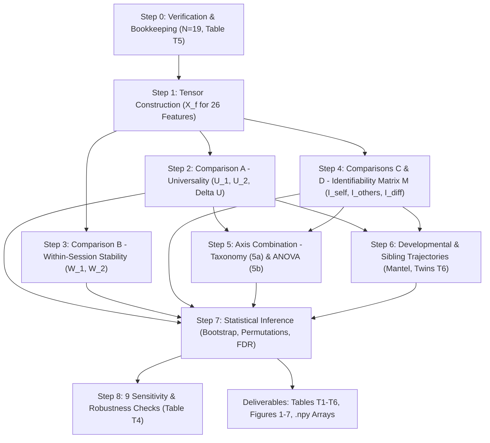

# Longitudinal Analysis Pipeline: Universality and Individuality of Infant EEG Network Constituents

**Author:** Based on the specification by @Aditi Bose (*Oct 20, 2026*)  
**Workspace:** `/home/aloo/HonoursM26`  
**Target Cohort:** $N = 19$ longitudinal infants across 2 sessions (`ses-1` and `ses-2`) with $K = 12$ artifact-free epochs each.

---

## 1. Executive Summary & Theoretical Framework

The primary objective of this analysis is to decouple, for every electrode node and functional edge centrality, what constitutes **universal organization** (shared across all developing infants) from what constitutes **individual uniqueness / fingerprinting** (stable, subject-specific characteristics).

This is achieved using a unified similarity metric—the **weighted Jaccard similarity**—evaluated across four fundamental comparison classes:

```
                                  COMPARISON FRAMEWORK
┌────────────────────────────────────────────────────────────────────────────────────────┐
│ Comparison A: Between-subject, within-session (ses-1 & ses-2)                          │
│               → Quantifies UNIVERSALITY (U_1, U_2) across the population               │
├────────────────────────────────────────────────────────────────────────────────────────┤
│ Comparison B: Within-subject, within-session (first K/2 vs second K/2 epochs)          │
│               → Quantifies WITHIN-SESSION STABILITY (W_1, W_2) & short-term ceiling    │
├────────────────────────────────────────────────────────────────────────────────────────┤
│ Comparison C: Within-subject, between-session (same infant across ~3-4 months)         │
│               → Quantifies LONGITUDINAL SELF-SIMILARITY (I_self)                       │
├────────────────────────────────────────────────────────────────────────────────────────┤
│ Comparison D: Between-subject, between-session (infant a at ses-1 vs infant b at ses-2)│
│               → Null developmental baseline (I_others)                                 │
└────────────────────────────────────────────────────────────────────────────────────────┘
```

> **Key Theoretical Axiom:** Individuality is **not** Comparison C alone. It is defined as **Differential Identifiability**:
> $$I_{\text{diff}} = I_{\text{self}} - I_{\text{others}}$$ (Amico2018quest; http://dx.doi.org/10.1038/s41598-018-25089-1)
> Because shared developmental maturation affects both $I_{\text{self}}$ and $I_{\text{others}}$ across the 3-month gap, subtracting $I_{\text{others}}$ isolates true individual specificity from normative maturation.

---

## 2. Cohort Definition & Subject Bookkeeping (Step 0)

### 2.1 Cohort Selection Rationale ($N = 19$)
The raw dataset contains 103 infants, with 22 subjects having recordings in both `ses-1` and `ses-2`.
Step 0 requires all subjects to possess at least $K = 12$ expert-annotated, artifact-free epochs (2.56 s duration, eyes-closed) in **both** sessions:
* `sub-NORB00074`: Excluded (only 1 window at `ses-1`).
* `sub-NORB00085`: Excluded (only 8 windows at `ses-1`).
* `sub-NORB00082`: Excluded (20 windows at `ses-1`, but only **1 window at `ses-2`**).
 $\color{red}{\textsf{did u cross-check these from metedata itself?}}$ 

**Selected Cohort:** Exactly **19 infants** satisfy $K \ge 12$ in both sessions. The first $K = 12$ chronological windows are used uniformly.

### 2.2 Table T5: Subject Bookkeeping Table
* Number of unique pairs within each session: $\binom{19}{2} = 171$ pairs.
* Identifiability cross-session matrix $M$: $19 \times 19$ matrix ($19$ self pairs, $342$ cross-subject pairs).

| Participant ID | Sex | Age `ses-1` (yr) $\color{red}{\textsf{--> (mo)}}$ | Age `ses-2` (yr) $\color{red}{\textsf{--> (mo)}}$ | Inter-session Gap (mo) | Epochs `ses-1` | Epochs `ses-2` | Note / Status |
| :--- | :---: | :---: | :---: | :---: | :---: | :---: | :--- |
| `sub-NORB00064` | M | 0.4262 | 0.4372 | 0.13 | 13 | 20 | Singleton (Short test-retest gap: ~4 days) |
| `sub-NORB00065` | M | 0.4344 | 0.7978 | 4.36 | 20 | 20 | Singleton |
| `sub-NORB00069` | F | 0.3852 | 0.5000 | 1.38 | 15 | 20 | Singleton (Intermediate gap: ~42 days) |
| `sub-NORB00070` | M | 0.2541 | 0.5055 | 3.02 | 15 | 20 | Singleton |
| `sub-NORB00075` | M | 0.2666 | 0.5055 | 2.87 | 20 | 20 | Singleton |
| `sub-NORB00077` | M | 0.2514 | 0.4917 | 2.88 | 20 | 20 | Singleton |
| `sub-NORB00078` | M | 0.2514 | 0.4767 | 2.70 | 20 | 20 | Singleton |
| `sub-NORB00079` | M | 0.2459 | 0.4716 | 2.71 | 15 | 20 | Singleton |
| `sub-NORB00080` | M | 0.2486 | 0.5583 | 3.72 | 20 | 20 | Singleton |
| `sub-NORB00081` | F | 0.2923 | 0.5716 | 3.35 | 15 | 20 | Singleton |
| `sub-NORB00083` | F | 0.2525 | 0.5442 | 3.50 | 20 | 20 | Singleton |
| `sub-NORB00084` | F | 0.2775 | 0.5555 | 3.34 | 15 | 20 | Singleton |
| `sub-NORB00086` | M | 0.2377 | 0.5250 | 3.45 | 20 | 20 | **Twin A** (Brother of `00087`) |
| `sub-NORB00087` | M | 0.2377 | 0.5250 | 3.45 | 20 | 20 | **Twin B** (Brother of `00086`) |
| `sub-NORB00089` | M | 0.2500 | 0.5466 | 3.56 | 24 | 20 | Singleton |
| `sub-NORB00090` | F | 0.2514 | 0.5300 | 3.34 | 15 | 20 | Singleton |
| `sub-NORB00094` | F | 0.2642 | 0.5416 | 3.33 | 12 | 20 | Singleton |
| `sub-NORB00096` | M | 0.2274 | 0.5000 | 3.27 | 20 | 20 | Singleton |
| `sub-NORB00103` | F | 0.2410 | 0.5233 | 3.39 | 35 | 20 | Singleton |

---

## 3. The 26 Feature Sets & Input Tensors (Step 1)

Every analysis reads from one tensor per feature set:
$$X_f \in \mathbb{R}^{19 \times 2 \times 12 \times n}$$
where:
* **Infants ($N=19$):** In fixed alphanumeric order (`sub-NORB00064` to `sub-NORB00103`).
* **Sessions ($S=2$):** $s \in \{1, 2\}$ (`ses-1`, `ses-2`).
* **Epochs ($K=12$):** $k \in \{1, \dots, 12\}$ chronological artifact-free segments.
* **Elements ($n$):** $n = 19$ for node features; $n = 171$ for edge features.

### 3.1 Fixed Element Ordering
To ensure strict reproducibility:
* **19 Nodes:** Grouped by region: Frontal (`Fp1, Fp2, F3, F4, F7, F8, FZ`), Central (`C3, C4, CZ`), Temporal (`T3, T4, T5, T6`), Parietal (`P3, P4, PZ`), Occipital (`O1, O2`).
* **171 Edges:** Grouped into 15 anatomical region pairs with increasing inter-region distance:
  `F-F` (21), `F-C` (21), `F-T` (28), `F-P` (21), `F-O` (14), `C-C` (3), `C-T` (12), `C-P` (9), `C-O` (6), `T-T` (6), `T-P` (12), `T-O` (8), `P-P` (3), `P-O` (6), `O-O` (1).

### 3.2 Feature Set Taxonomy

| Feature ID | Feature Domain | Representation | Centrality / Metric | Dimension ($n$) | Distance Metric / Binarization |
| :---: | :--- | :--- | :--- | :---: | :--- |
| **f01** | Broadband | Weighted | Correlation weight $W_{ij} = \|r_{ij}\|$ | 171 | Direct absolute correlation |
| **f02** | Broadband | Weighted | Node Betweenness | 19 | Brandes algorithm, $d_{ij} = 1/w_{ij}$ |
| **f03** | Broadband | Weighted | Edge Betweenness | 171 | Girvan-Newman, $d_{ij} = 1/w_{ij}$ |
| **f04** | Broadband | Weighted | Node Strength | 19 | Sum of incident edge weights |
| **f05** | Broadband | Weighted | Edge Strength | 171 | Average strength of incident endpoints |
| **f06** | Broadband | Weighted | Node Eigenvector | 19 | Principal eigenvector of $W$ |
| **f07** | Broadband | Weighted | Edge Eigenvector | 171 | Line graph eigenvector centrality |
| **f08** | Broadband | Weighted | Node Closeness | 19 | Harmonic/Shortest path, $d_{ij} = 1/w_{ij}$ |
| **f09** | Broadband | Weighted | Edge Closeness | 171 | Line graph shortest path |
| **f10** | Broadband | Binary | Adjacency matrix $A_{ij}$ | 171 | GCC adaptive threshold ($\tau_c$) |
| **f11** | Broadband | Binary | Node Betweenness | 19 | Unweighted shortest paths |
| **f12** | Broadband | Binary | Edge Betweenness | 171 | Unweighted shortest paths |
| **f13** | Broadband | Binary | Node Degree | 19 | Unweighted degree |
| **f14** | Broadband | Binary | Edge Strength | 171 | Average degree of incident endpoints |
| **f15** | Broadband | Binary | Node Eigenvector | 19 | Principal eigenvector of $A$ |
| **f16** | Broadband | Binary | Edge Eigenvector | 171 | Line graph unweighted eigenvector |
| **f17** | Broadband | Binary | Node Closeness | 19 | Unweighted shortest path |
| **f18** | Broadband | Binary | Edge Closeness | 171 | Line graph unweighted shortest path |
| **f19** | Delta (0.5–4 Hz) | Weighted | Edge Weight $W_{ij}$ | 171 | Absolute Pearson $r$ on filtered EEG |
| **f20** | Delta (0.5–4 Hz) | Binary | Edge Adjacency $A_{ij}$ | 171 | GCC adaptive threshold ($\tau_c$) |
| **f21** | Theta (4–8 Hz) | Weighted | Edge Weight $W_{ij}$ | 171 | Absolute Pearson $r$ on filtered EEG |
| **f22** | Theta (4–8 Hz) | Binary | Edge Adjacency $A_{ij}$ | 171 | GCC adaptive threshold ($\tau_c$) |
| **f23** | Alpha (8–13 Hz) | Weighted | Edge Weight $W_{ij}$ | 171 | Absolute Pearson $r$ on filtered EEG |
| **f24** | Alpha (8–13 Hz) | Binary | Edge Adjacency $A_{ij}$ | 171 | GCC adaptive threshold ($\tau_c$) |
| **f25** | Beta (13–30 Hz) | Weighted | Edge Weight $W_{ij}$ | 171 | Absolute Pearson $r$ on filtered EEG |
| **f26** | Beta (13–30 Hz) | Binary | Edge Adjacency $A_{ij}$ | 171 | GCC adaptive threshold ($\tau_c$) |

---

## 4. Mathematical Definitions & Methodological Rules

### 4.1 Weighted Jaccard Formulation & 0/0 Rule

For two feature vectors $x_1, x_2 \ge 0$:
1. **Element-level Jaccard $J(e)$:**
   $$J(e) = \frac{\min\{x_1(e), x_2(e)\}}{\max\{x_1(e), x_2(e)\}}$$
   * **The $0/0$ Rule:** When both $x_1(e) = 0$ and $x_2(e) = 0$, the ratio is undefined ($0/0$). It is set to `NaN` and excluded from the average using `np.nanmean`. This strictly adheres to the classical Jaccard formulation, which ignores joint absences.
   * If all pairs for an element are `NaN`, $J(e) = \text{NaN}$. The undefined fraction is tracked and reported per element in Table T2.
   * The legacy rule ($0/0 \to 0$) is evaluated separately as a Step 8 sensitivity check.

2. **Recording-level Weighted Jaccard $S$:**
   Evaluated across all elements simultaneously for an epoch pair $(k_1, k_2)$:
   $$S^{(k_1, k_2)} = \frac{\sum_{e=1}^n \min\{x_{R_1, k_1}(e), x_{R_2, k_2}(e)\}}{\sum_{e=1}^n \max\{x_{R_1, k_1}(e), x_{R_2, k_2}(e)\}}$$
   * Joint absences ($0+0$) naturally contribute $0$ to both numerator and denominator sums without requiring a special exception.
   * Overall recording similarity is the mean across the epoch pairing set $P$:
     $$S_{R_1 R_2} = \frac{1}{|P|} \sum_{(k_1, k_2) \in P} S^{(k_1, k_2)}$$

### 4.2 Epoch Pairing Schemes ($P$)

| Comparison | Description | Pairing Set $P$ | Count $|P|$ |
| :--- | :--- | :--- | :---: |
| **A, C, D** | Cross-recording (between infants or between sessions) | Matched indices: $(k, k)$ for $k \in \{1, \dots, K\}$ | $K = 12$ |
| **B** | Within-session split-half stability | Half-shift: $(k, k + K/2)$ for $k \in \{1, \dots, K/2\}$ | $K/2 = 6$ |
| **Step 8 (Check 2)** | Robustness check | All combinatorial pairs: $(k_1, k_2)$ for all $k_1, k_2$ | $K \times K = 144$ |

---

## 5. Sequential Step-by-Step Implementation Phases



---

### Phase 1: Feature Tensor Construction (Step 1)
* **Goal:** Extract and save 26 intermediate tensors $X_f \in \mathbb{R}^{19 \times 2 \times 12 \times n}$ into `processed_tensors/`.
* **Execution:**
  1. Load precomputed absolute correlation matrices for `ses-1` and `ses-2` from `correlation_matrices_segment_wise_absolute/`.
  2. Apply GCC thresholding on each window to obtain binary adjacency $A_{ij}$ (saving the critical threshold $\tau_c$ and edge density).
  3. Compute graph centrality measures (node/edge betweenness, strength, eigenvector, closeness) via `networkx`.
  4. For the 8 frequency band features, load filtered segments from EDFs for Delta, Theta, Alpha, Beta, compute Pearson $|r|$ and GCC binarization for both sessions.

---

### Phase 2: Universality Across the Population (Step 2 — Comparison A)
* **Goal:** Quantify population-wide shared topology for each session separately ($s \in \{1, 2\}$).
* **Metrics:**
  1. **Element-level Universality:**
     $$U_s(e) = \frac{1}{171} \sum_{a < b} J_{(a,s), (b,s)}(e)$$
     Yields a $171 \times n$ matrix per feature/session.
  2. **Recording-level Universality:**
     $$U_s = \frac{1}{171} \sum_{a < b} S_{(a,s), (b,s)}$$
  3. **Per-infant Universality:**
     $$u_s(a) = \frac{1}{18} \sum_{b \ne a} S_{(a,s), (b,s)}$$
  4. **Regional Universality:** Grouped average $U_s(g)$ across the 5 node regions and 15 edge region pairs.
  5. **Element-Shuffle Null Model (Significance testing):**
     * For each infant pair $(a, b)$, apply an identical random permutation $\pi$ across element labels.
     * Recompute $U_s(e)$ across 10,000 iterations.
     * One-sided $p$-value:
       $$p = \frac{1 + \sum [\text{null} \ge \text{observed}]}{1 + 10{,}000}$$

---

### Phase 3: Within-Session Stability (Step 3 — Comparison B)
* **Goal:** Establish the theoretical ceiling of self-similarity and measure short-term state variability.
* **Metrics:**
  1. **Epoch Split:** For each infant and session, split 12 epochs into First Half ($k \in \{1, \dots, 6\}$) and Second Half ($k \in \{7, \dots, 12\}$), pairing $(k, k+6)$.
  2. **Self-Similarity:**
     * Element-level: $W_s(a, e) = J_{(a,s,\text{first}), (a,s,\text{second})}(e)$
     * Recording-level: $W_s(a) = S_{(a,s,\text{first}), (a,s,\text{second})}$
     * Cohort mean: $W_s(e)$ and $W_s$.
  3. **Matched Others Baseline:**
     Compare infant $a$'s first half with infant $b$'s second half ($b \ne a$) using identical pairing $(k, k+6)$:
     $$O_s(a) = \frac{1}{18} \sum_{b \ne a} S_{(a,s,\text{first}), (b,s,\text{second})}$$
  4. **Within-Session Identifiability:** $W_s(a) - O_s(a)$ tested against 0 via infant-level bootstrap.
  5. **Odd/Even Sensitivity:** Repeat split pairing odd epochs with subsequent even epochs $(k, k+1)$.

---

### Phase 4: Longitudinal Identifiability & Fingerprinting (Step 4 — Comparisons C & D)
* **Goal:** Construct cross-session similarity matrix $M$ and evaluate fingerprinting accuracy across development.
* **Metrics:**
  1. **Identifiability Matrix $M \in \mathbb{R}^{19 \times 19}$:**
     $$M[a, b] = S_{(a, 1), (b, 2)}$$
     Rows = `ses-1`, Columns = `ses-2`.
  2. **Global Identifiability Parameters:**
     * Self-similarity (Comparison C):
       $$I_{\text{self}} = \frac{1}{19} \sum_{a=1}^{19} M[a, a]$$
     * Others-similarity (Comparison D):
       $$I_{\text{others}} = \frac{1}{19 \times 18} \sum_{a \ne b} M[a, b]$$
     * **Differential Identifiability:**
       $$I_{\text{diff}} = (I_{\text{self}} - I_{\text{others}}) \times 100$$
  3. **Identification Accuracy (1-Nearest Neighbor):**
     * **Forward (`ses-1` $\to$ `ses-2`):** For row $a$, predicted identity is $\arg\max_b M[a, b]$. Correct if $b = a$.
     * **Backward (`ses-2` $\to$ `ses-1`):** For column $b$, predicted identity is $\arg\max_a M[a, b]$. Correct if $a = b$.
     * Ties count as incorrect. Chance baseline is $1/19 = 5.26\%$.
  4. **Element-level Identifiability:**
     Compute $M_e[a, b] = J_{(a, 1), (b, 2)}(e)$ to yield $I_{\text{self}}(e), I_{\text{others}}(e)$, and $I_{\text{diff}}(e)$.

---

### Phase 5: Combining the Two Axes (Step 5)

#### 5.1 Universality–Individuality 2D Plane (Step 5a)
Plot every element in a 2D space:
* **X-axis:** Overall Universality $U(e) = \frac{U_1(e) + U_2(e)}{2}$
* **Y-axis:** Individuality $I_{\text{diff}}(e)$

Classify each element into four functional quadrants using FDR-corrected significance thresholds:

| Quadrant Class | Universality $U(e)$ (vs Shuffle Null) | Individuality $I_{\text{diff}}(e)$ (vs Permutation Null) | Functional Interpretation |
| :--- | :---: | :---: | :--- |
| **Universal Core** | **Significant** (both sessions) | Not significant | Conserved developmental infrastructure across all infants |
| **Individual Marker** | Not significant | **Significant** | Pure neural fingerprinting constituent |
| **Universal & Individual**| **Significant** (both sessions) | **Significant** | High shared baseline with stable infant-specific modulation |
| **Variable / Redundant** | Not significant | Not significant | Fluctuating or uninformative constituents |

#### 5.2 State vs. Trait Variance Decomposition (Step 5b)
On the raw epoch values $x_{a, s, k}(e)$ ($19 \text{ infants} \times 2 \text{ sessions} \times 12 \text{ epochs} = 456 \text{ observations}$):
1. **Rank-based Inverse Normal Transformation:**
   Transform $x(e)$ across all 456 observations to resolve skewness and zero inflation.
2. **Linear Mixed-Effects Model:**
   $$y = \mu + u_a + v_{a, s} + \varepsilon$$
   * $u_a \sim \mathcal{N}(0, \sigma^2_{\text{Subject}})$: Trait (Infant-specific variance)
   * $v_{a, s} \sim \mathcal{N}(0, \sigma^2_{\text{Session}})$: Session / Developmental variance
   * $\varepsilon \sim \mathcal{N}(0, \sigma^2_{\text{Epoch}})$: State / Moment-to-moment noise
3. **Partition Proportions:**
   $$\text{Prop}_{\text{Trait}} = \frac{\sigma^2_u}{\sigma^2_{\text{total}}}, \quad \text{Prop}_{\text{Session}} = \frac{\sigma^2_v}{\sigma^2_{\text{total}}}, \quad \text{Prop}_{\text{State}} = \frac{\sigma^2_\varepsilon}{\sigma^2_{\text{total}}}$$
4. **Age-Adjusted Model:**
   Refit adding fixed effect of mean-centered age: $y = \mu + \beta \cdot \text{age}_c + u_a + v_{a, s} + \varepsilon$.

---

### Phase 6: Developmental & Sibling Analyses (Step 6)

1. **Developmental Shift in Universality ($\Delta U$):**
   * $\Delta U = U_2 - U_1$ (recording level) and $\Delta U(e) = U_2(e) - U_1(e)$ (element level).
   * Evaluate using infant-level bootstrap with FDR correction across elements.
2. **Decay with Inter-Session Gap:**
   * Compute Spearman correlation $\rho$ between self-similarity $M[a, a]$ and inter-session time gap (in days).
   * Compute Spearman correlation between $i_{\text{diff}}(a)$ and time gap.
   * Null model: 10,000 permutations of the interval vector.
   * Specific reporting: Highlight short-gap test-retest infant `sub-NORB00064` (4 days) and intermediate infant `sub-NORB00069` (42 days).
3. **Age Discrepancy vs. Network Similarity (Mantel Test):**
   * Matrix 1: $19 \times 19$ similarity matrix $S_{(a, s), (b, s)}$.
   * Matrix 2: $19 \times 19$ absolute age difference matrix $D[a, b] = |\text{age}_a - \text{age}_b|$ (days).
   * Statistic: Spearman rank correlation $\rho$ across the 171 upper-triangle elements.
   * Null model: 10,000 simultaneous row/column infant permutations of matrix $D$.
4. **Twin / Sibling Pair Analysis (`sub-NORB00086` & `sub-NORB00087` — Table T6):**
   * Percentile rank of sibling pair similarity $S_{(86, s), (87, s)}$ among all 171 pairs.
   * Rank against matched control pairs (pairs involving either sibling, and non-sibling pairs with $|\Delta\text{age}| \le 7$ days).
   * Cross-session cross-identification: Evaluate $M[86, 87]$ and $M[87, 86]$ to determine if twin A is misidentified as twin B.
   * Shared elements: Elements where sibling similarity exceeds the 95th percentile of non-sibling pairs.

---

### Phase 7: Statistical Inference Architecture (Step 7)

```
Statistical Inference Rules:
├── Pair Non-Independence: Never treat 171 pairs as independent samples!
├── Resampling Unit: Always resample or permute INFANTS (N = 19), not pairs
├── Bootstrap: B = 10,000 infant resamples -> Percentile 95% CI [2.5%, 97.5%]
├── Permutation Tests: 10,000 permutations -> Exact p = (1 + count(null >= obs)) / (1 + 10,000)
└── Multiple Testing: Benjamini-Hochberg FDR at q < 0.05 across elements and feature sets
```

1. **Infant-Level Bootstrap (10,000 resamples):**
   * For pair statistics ($U_1, U_2, \Delta U, I_{\text{others}}$): Draw 19 infant indices $d_1, \dots, d_{19}$ with replacement. Evaluate only pairs where $d_p \ne d_q$.
   * For infant-level metrics ($I_{\text{self}}, W_s$): Ordinary bootstrap over the 19 values.
   * Paired differences (e.g. Weighted vs. Binary, Within- vs. Between-region): Evaluated within the same bootstrap resample.
2. **Permutation Null Tests (10,000 iterations):**
   * Identifiability null: Randomly permute the columns of $M$ (`ses-2` labels) to obtain the null distribution for $I_{\text{diff}}$ and identification accuracy.
   * Element-wise identifiability: Apply the identical column permutation across all element matrices $M_e$ simultaneously, preserving spatial covariance.

---

### Phase 8: Robustness & Sensitivity Checks (Step 8 — Table T4)

To ensure conclusions are not artifacts of hyperparameter choices, rerun the primary metrics ($U_1, U_2, I_{\text{diff}}$, accuracy, taxonomy counts) across 9 specific sensitivity variations:

1. **$0/0$ Replacement:** Set $0/0 \to 0$ instead of excluding `NaN`.
2. **Combinatorial Epoch Pairing:** Average over all $12 \times 12 = 144$ epoch combinations instead of diagonal $(k, k)$.
3. **Epoch Window Length:** Truncate to $K = 6$ epochs instead of $K = 12$.
4. **Twin Exclusion:** Recompute with $N = 17$ infants, excluding twin pair `sub-NORB00086` and `sub-NORB00087`.
5. **Pattern-Only Normalization:** Divide each epoch vector by its $L_1$ sum ($\sum_e x(e) = 1$) to remove global amplitude shifts before computing Jaccard.
6. **Reference Montage:** Re-reference continuous EEG to average reference before computing correlation matrices.
7. **Volume Conduction Control:** Compute debiased weighted phase lag index (dwPLI) via MNE Connectivity instead of Pearson $|r|$.
8. **Fixed-Density Binarization:** Replace GCC thresholding with fixed top-$m$ edge thresholding (where $m = \text{median GCC edge count}$).
9. **Physical Distance Regression:** Regress Euclidean 3D inter-electrode distance out of edge centralities, re-evaluating universality on distance-adjusted residuals.

---

## 6. Formal Deliverables

### 6.1 Tables
* **Table T1 (Global Summary):** 26 rows (one per feature set). Columns: $U_1, U_2, \Delta U, W_1, W_2, I_{\text{self}}, I_{\text{others}}, I_{\text{diff}}$, Accuracy (Forward, Backward, Mean), Mantel $\rho$ (`ses-1`, `ses-2`). Reported as Mean $\pm$ SD, Median [95% CI], and FDR-corrected $q$-values.
* **Table T2 (Element Results):** Feature $\times$ Element table. Columns: Label, Region, Hemisphere, Within/Between region flag, Euclidean distance, $U_1(e), U_2(e), W(e), I_{\text{diff}}(e)$, raw $p$, FDR $q$, Taxonomy Class, and fraction of $0/0$ instances.
* **Table T3 (Variance Partition):** Feature $\times$ Element table. Proportions of Infant (Trait), Session, and Epoch (State) variance, without and with age term, plus model convergence flags.
* **Table T4 (Robustness Summary):** Check $\times$ Feature table reporting main metrics under each of the 9 sensitivity analyses.
* **Table T5 (Bookkeeping):** Completed subject metadata table (Section 2.2).
* **Table T6 (Twin / Sibling Analysis):** 26 rows (one per feature set) summarizing all twin comparisons.

### 6.2 Figures (Vector PDF Format)
* **Figure 1:** $19 \times 19$ Identifiability matrix $M$ heatmaps per feature (rows: `ses-1`, columns: `ses-2`, diagonal highlighted).
* **Figure 2:** Forest plots showing $U_1, U_2, W_1, W_2, I_{\text{self}}, I_{\text{others}}$ with 95% bootstrap CIs side-by-side.
* **Figure 3:** 2D Universality vs. Individuality quadrant scatter plots ($U(e)$ vs $I_{\text{diff}}(e)$) with colored regions and quadrant counts.
* **Figure 4:** Topographical scalp maps showing node $I_{\text{diff}}(e)$ and significant FDR edge connections.
* **Figure 5:** Developmental scatter plots: $\Delta U$ per feature, and $I_{\text{self}}(a)$ vs. inter-session interval (highlighting `00064` and `00069`).
* **Figure 6:** Stacked bar charts of variance decomposition ($\sigma^2_{\text{Subject}}, \sigma^2_{\text{Session}}, \sigma^2_{\text{Epoch}}$) per feature and region.
* **Figure 7:** Sorted element heatmaps across all 171 pairs, sorted by $|\Delta\text{age}|$, with Midline designated as "M".

### 6.3 Data Artifacts
* Intermediate arrays stored in `processed_tensors/` as `.npy` files accompanied by `processed_tensors/README.md` defining axes and shapes:
  * `X_f.npy` shape $(19, 2, 12, n)$
  * `M_f.npy` shape $(19, 19)$
  * `J_pair_f.npy` shape $(171, n)$

---

## 7. Directory Architecture of the Pipeline

```
/home/aloo/HonoursM26/
├── ANALYSIS_PIPELINE.md                   <- Complete methodology & blueprint (this file)
├── analysis_pipeline/
│   ├── config.py                          <- Subjects, channels, region mapping, edge pairs
│   ├── 01_extract_tensors.py              <- Builds (19, 2, 12, n) tensors for all 26 features
│   ├── 02_compute_universality.py         <- Step 2: Comparison A (U_1, U_2, Delta U, nulls)
│   ├── 03_compute_within_session.py       <- Step 3: Comparison B (W_1, W_2, matched others)
│   ├── 04_compute_identifiability.py      <- Step 4: Comparisons C & D (M, I_diff, accuracy)
│   ├── 05_taxonomy_and_variance.py        <- Step 5: 4-quadrant plane & ANOVA mixed models
│   ├── 06_developmental_and_twins.py      <- Step 6: Mantel tests, age gap correlations, twins
│   ├── 07_robustness_checks.py            <- Step 8: 9 sensitivity analyses
│   ├── 08_export_tables.py                <- Compiles Tables T1-T6 (CSV + Markdown)
│   └── 09_generate_figures.py             <- Generates Figures 1-7 (PDF + PNG)
├── processed_tensors/                     <- Saved .npy tensors & README
├── tables/                                <- Output CSV tables (T1-T6)
└── figures/                               <- Output Vector PDF figures (Fig1-Fig7)
```

